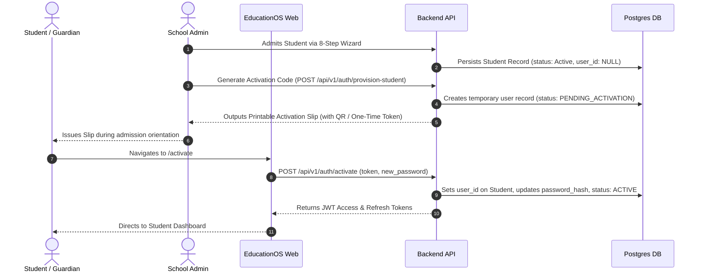

# EducationOS — Account Activation & Password Recovery Runbook
**Release Track:** RC3 — Academic & Experience Transformation  
**Status:** Canonical Operations Manual  
**Applies To:** School Administrators, IT Support Staff, Help Desk Personnel  

---

## 1. Overview & Security Policy

In accordance with institutional privacy standards and multi-tenant security guarantees:
- Passwords are never stored in plain text or reversible encryption.
- Account activation links or temporary OTP codes expire within **15 minutes**.
- Password reset attempts are rate-limited to **3 requests per 15 minutes** per IP/identifier to protect against brute-force attacks.
- Only institutional administrators or verified guardian mobile numbers can initiate password resets for dependent students.

---

## 2. Student Initial Account Activation Workflow

### Activation Slip Content Requirements:
1. Institution Name & Logo (dynamically loaded via `useInstitution()`).
2. Student Full Name & Bengali Name.
3. Admission Number (e.g. `ADM-2026-0812`).
4. Assigned Class, Section, and Roll Number.
5. Unique 8-digit Activation Token or Scannable URL:
   `https://[institution-domain]/activate?token=ABC123XYZ`

---

## 3. Guardian Password Recovery Workflow

### Step 1: Self-Service Mobile Recovery
1. Guardian visits `/forgot-password`.
2. Enters registered mobile number (e.g. `017XXXXXXXX`).
3. If the phone number matches an active `guardians` record within the tenant:
   - System dispatches a 6-digit numeric OTP via SMS gateway.
   - Generates a cryptographically secure session challenge (`idempotency_key`).
4. Guardian enters OTP and desired new password (minimum 8 characters).
5. Endpoint `POST /api/v1/auth/reset-password-with-otp` validates hash and updates credential.

### Step 2: Administrative Reset (Help Desk Override)
If a guardian lost access to their registered SIM card:
1. School administrative staff verifies guardian identity in person (NID verification or birth registration document match).
2. Admin opens **Guardians Directory** in `/dashboard/guardians`.
3. Selects the verified guardian profile and clicks **"Generate One-Time Reset Link"**.
4. An administrative diff audit log is committed with staff `user_id`.
5. Guardian receives a temporary 1-hour secure password reset link.

---

## 4. Troubleshooting & Common Failure Modes

| Symptom | Root Cause | Resolution Action |
| :--- | :--- | :--- |
| **"Invalid or Expired Activation Code"** | Token expired (> 15 minutes) or already consumed. | IT Admin regenerates token via Student 360 profile inline action. |
| **"Student Identity Mismatch"** | Attempting activation for a different tenant's admission number. | Ensure user is browsing the correct school subdomain or workspace. |
| **"Multiple Students Linked to Same Phone"** | Legitimate sibling enrollment in same institution. | System aggregates siblings under one Guardian profile; user chooses which child to inspect from portal header. |
| **"Account Locked / Too Many Attempts"** | Exceeded 5 failed attempts in 10 minutes. | Automatically unlocks after 15 minutes or Admin can manually clear lock via `/api/v1/auth/unlock-user`. |

---

## 5. Audit Logging & Compliance

All account creation, password modification, and role assignment events are logged in the `audit_logs` table with:
- `tenant_id`
- `actor_id` (User ID or `SYSTEM_PROVISIONER`)
- `action_type` (`ACCOUNT_ACTIVATED`, `PASSWORD_RESET`, `GUARDIAN_LINKED`)
- `ip_address` & `user_agent`
- `created_at` in Asia/Dhaka timezone

