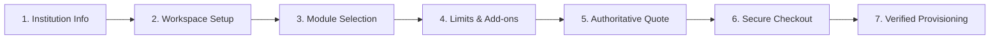

# EducationOS — Self-Service Onboarding, Module Marketplace & Commerce Architecture (Stage 12.6)

**Document Version:** 1.0.0-PROD  
**Author:** Principal SaaS Architect & Payments Engineering Lead  
**Target Milestone:** Stage 12.6 Implementation  
**Execution Mode:** Gated Architectural Plan (Awaiting Authorization)

---

## 1. Executive Summary & Core Invariants

Stage 12.6 replaces the legacy, single-form tenant insertion (`/api/v1/auth/register-school`) with a **7-Step Self-Service Onboarding & Modular Commerce Engine** (`/onboard`).

### Non-Negotiable Commerce Invariants
1. **Zero Frontend Authority for Pricing:** The frontend is untrusted. All prices, discount percentages, proration amounts, taxes, and quotas are computed strictly server-side via `POST /api/v1/billing/quote`.
2. **Zero Entitlement from Redirects:** Navigating to `/dashboard?payment_success=true` or passing client-side assertions grants zero permissions. Paid entitlements activate **exclusively** upon cryptographically verified webhook execution or auditable root-admin approval.
3. **Replay & Tamper Defense:** Webhooks from payment gateways (bKash, SSLCOMMERZ, Stripe) enforce HMAC-SHA256 signature verification, exact amount and currency verification, and provider event ID uniqueness via `BillingWebhookEvent`.
4. **Bounded-Context Isolation:** SaaS software subscriptions and invoice records (`billing_invoices`) remain strictly segregated from student tuition fee records (`invoices`).
5. **Atomic Multi-Entity Provisioning:** Creation of `Tenant`, `Organization`, `Workspace`, `User`, `InstitutionSubscription`, and `TenantEntitlement` occurs within an atomic database transaction. If any step fails, the entire transaction rolls back cleanly with zero orphaned rows.

---

## 2. Seven-Step Onboarding Customer Journey (`/onboard`)



### Step 1: Institutional Profile & Authorized Representative
- **Institution Data:** Legal Institution Name, Institutional Category (School, Madrasah, College, Coaching Center, Academy), EIIN / Registration Number (optional for academies, validated if provided), Campus Street Address, City/District, Division.
- **Authorized Signatory:** Full Name, Designation (Principal, Founder, Director, Headmaster), Institutional Email (verified via OTP), Contact Mobile Phone (validated against Bangladesh 11-digit format `01XXXXXXXXX`).

### Step 2: Organization & Workspace Modeling
- **Institutional Structure Selection:**
  - *Option A: Standalone K-12 School* (`workspace_type="school"`).
  - *Option B: Academic Coaching Center* (`workspace_type="academy"`).
  - *Option C: Unified Campus* (Dual entity: Morning School + Evening Academy).
- **Workspace Domain Identifier:**
  - Unique subdomain / school code prefix (e.g. `SCH-DHAKA-01` or `FAC-CUMILLA`).
  - Validated server-side for uniqueness across `workspaces.code`.

### Step 3: Module Marketplace Selection
Institutions dynamically select their operating modules:
- **Core Operating Modules (Included in Base Plans):**
  - `attendance`: Biometric & 1-tap mobile roll call.
  - `student_records`: Student demographics, guardian profiles, admissions ledger.
  - `routine`: Timetable conflict engine with teacher collision defense.
  - `notices`: Multi-channel communication & announcements.
  - `results`: Continuous assessment & report cards.
- **Advanced & Specialized Modules (Add-ons or Higher Tiers):**
  - `nctb_grading`: Full NCTB Pass/Fail rules, GPA 5.0 scale, term tabulations.
  - `live_exams`: High-concurrency live MCQ exams with -0.25 negative marking.
  - `omr_scanner`: Mobile camera-based OMR answer sheet scanner.
  - `fee_ledger`: Double-entry counter fee collections & receipts.
  - `ai_question_generator`: AI NCTB question paper generator.
  - `socratic_doubt_solver`: AI Socratic step-by-step problem solver for students.
  - `ipemis_connector`: 1-click government IPEMIS / BANBEIS data sync.

### Step 4: Quotas, Add-on Packs & AEGIS-X Security Pro
- **Active Student Tier Selection:**
  - Tier 1: Up to 100 Students (Starter)
  - Tier 2: Up to 500 Students (Growth)
  - Tier 3: Up to 1,500 Students (Professional)
  - Tier 4: Up to 5,000 Students (Enterprise)
- **AI Quota Packs:**
  - Standard: Included in tier (30 to 300 questions/mo).
  - Power Pack: +1,000 AI Questions (৳1,000/mo).
  - Unlimited Socratic Tutoring Pack (৳2,500/mo).
- **Security & Governance:**
  - Optional: **AEGIS-X Security Pro** (৳1,500/mo) — Dedicated append-only audit ledger, IP geofencing, multi-branch security sentinel, and priority SLA.

### Step 5: Authoritative Dynamic Order Summary
- The client calls `POST /api/v1/billing/quote` passing selected modules, tiers, add-ons, and billing cycle.
- **Server-Side Quote Response:**
  - Base plan amount (BDT).
  - Add-on module fees (itemized).
  - Annual billing discount (e.g., 20% savings — 12 months for the price of 10).
  - Government VAT/Tax breakdown (if applicable).
  - Total Payable Net Amount (Decimal).
  - Quote Token (HMAC-signed, valid for 30 minutes).

### Step 6: Checkout Execution (Free Trial vs Paid)
- **Pathway A: 14-Day Full Free Trial:**
  - Available for all first-time institutions.
  - Activates `subscription_status="TRIALING"`, `plan_tier="free_trial"`, `valid_until=now + 14 days`.
  - Zero credit card or payment credential required.
- **Pathway B: Immediate Paid Activation:**
  - Select payment rail: **bKash Tokenized Checkout**, **SSLCOMMERZ Gateway**, or **International Stripe**.
  - Server generates `payment_reference` (`SUB-XXXXXX-XXXXXXXX`) and signs checkout URL.
  - User redirected to gateway or seamless popup modal.

### Step 7: Verified Provisioning & Seamless Redirect
- Upon gateway callback confirmation or free trial verification:
  1. Transaction commits atomic provisioning of `Tenant`, `Organization`, `Workspace`, root `User` (`role="admin"`), and `WorkspaceMembership`.
  2. `InstitutionSubscription` activated with appropriate expiration date.
  3. `TenantEntitlement` records provisioned for all selected modules.
  4. Immutable `BillingInvoice` generated with line items.
  5. JWT access and refresh tokens generated and securely issued.
  6. User immediately redirected to `/dashboard` with an automated welcome onboarding checklist.

---

## 3. Custom Module Request Workflow

When an institution requires custom enterprise integrations (e.g. customized biometric hardware driver, dedicated school bus GPS tracker, legacy database migration):
1. User clicks **"Request Custom Enterprise Module"** in Step 3.
2. Fills brief requirements specification modal.
3. System creates a `ApprovalTask(task_type="CUSTOM_MODULE_REQUEST", status="pending_review")` and records entry in `BillingAuditLog`.
4. **Security Invariant:** Custom modules are **never** provisioned automatically. They remain dormant until technical review and manual admin entitlement provisioning.

---

## 4. Payment Gateway Evaluation & Regulatory Compliance

| Gateway | Supported Currencies | Merchant Eligibility (Bangladesh) | Integration Mechanism | Strengths & Regulatory Constraints |
|---|---|---|---|---|
| **bKash Tokenized Checkout** | **BDT Only** | Bangladesh Trade License, TIN, BIN, Corporate Bank Account, bKash Merchant Agreement. | REST API with Tokenized URL / App Key / App Secret / HMAC Webhook. | Dominant mobile financial service in BD (>85% parent adoption). Strictly domestic transactions in BDT. Instant settlement. |
| **SSLCOMMERZ** | **BDT (Primary), USD, EUR, GBP** | Bangladesh Trade License, Certificate of Incorporation, TIN, BIN, Corporate Bank Account. | Server-to-Server Session Init (`/gwprocess/v4/api.php`), IPN Webhook callback. | Aggregates 30+ payment channels: Visa, Mastercard, AMEX, bKash, Nagad, Rocket, Upay, Bank transfers. Requires annual PCI-DSS compliance certification. |
| **Stripe** | **USD, EUR, GBP, AUD, etc.** | Foreign Entity (US/UK/SG Stripe Atlas) or International Partner Entity. Not natively supported for domestic BD bank accounts. | Stripe Checkout Sessions / PaymentIntents, Webhook signing secret (`whsec_*`). | Gold standard for international English-medium schools and overseas branches. Seamless recurring billing subscriptions. |

### Gateway Routing Decision Engine
- If Billing Currency = `BDT` and Channel = Mobile Banking ➔ Route to **bKash Tokenized Checkout**.
- If Billing Currency = `BDT` and Channel = Card/NetBanking/All ➔ Route to **SSLCOMMERZ Hosted Session**.
- If Billing Currency = `USD` or International IP ➔ Route to **Stripe Checkout**.

---

## 5. Webhook Security, Replay Defense & Idempotency Engine

```
[Gateway Callback] ──► [HMAC-SHA256 Signature Check] (Fail -> 401)
                             │ Pass
                             ▼
             [Replay Protection Query: BillingWebhookEvent]
                             │
            ┌────────────────┴────────────────┐
     Event Exists & Processed?       Event New?
            │                                 │
            ▼                                 ▼
   Return 200 (ALREADY_PROCESSED)    Acquire DB Lock on SubscriptionPayment
                                              │
                                              ▼
                                     Verify Amount & Currency Match
                                              │
                                              ▼
                                     Activate Subscription
                                     Generate BillingInvoice
                                     Provision Entitlements
                                     Record WebhookEvent (processed=True)
                                     Commit Transaction
```

### Verification Matrix
1. **Signature Verification:** Compute HMAC-SHA256 over raw request body using provider secret (`PAYMENT_WEBHOOK_SECRET`). Rejection threshold: 100% fail-closed.
2. **Replay Protection:** Query `billing_webhook_events` for `(gateway, event_id)`. If present and processed, return HTTP 200 `ALREADY_PROCESSED` with zero state mutation.
3. **Amount Reconciliation:** Compare `payload.amount` with `intent.amount` using `Decimal(str(...))` exact equality. Any mismatch logs a security alert and raises HTTP 409 Conflict.
4. **Idempotent Provisioning:** Even if network packets are duplicated 10 times, the tenant subscription validity is extended exactly once.
