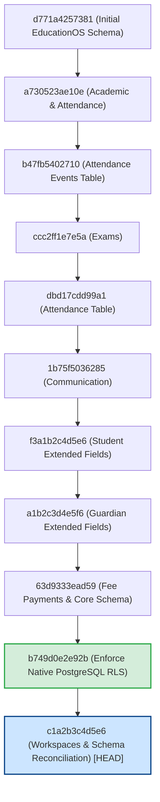

# Stage 02: Database & Migration Integrity Reconstruction Report

**Project:** EducationOS (SchoolOS)  
**Stage:** 02 — Database & Migration Integrity Reconstruction  
**Architect:** Principal Software Architect & Application Security Engineer  
**Date:** 2026-11-03  
**Status:** COMPLETE (GO FOR STAGE 03)  

---

## 1. Objectives

The primary objective of Stage 02 was to restore a reliable, migration-safe, multi-tenant PostgreSQL database architecture without losing existing application data, breaking tenant relationships, or introducing schema inconsistencies.

Key milestones:
1. Reconstruct and validate the complete Alembic Directed Acyclic Graph (DAG) from root (`d771a4257381`) to head (`c1a2b3c4d5e6`).
2. Fix broken parent references (`a829f0c2e91a` -> `63d9333ead59`) in `xxxx_enforce_native_rls.py`.
3. Fix mismatched table references in the Row-Level Security (RLS) migration (`attendance_records` -> `attendance_events`).
4. Resolve `ConfigParser` interpolation crashes in `alembic/env.py` caused by unescaped percent-encoded credentials in `DATABASE_URL`.
5. Reconcile declarative SQLAlchemy models (`Workspace`, `Organization`, `WorkspaceMembership`, `SchoolProfile`, `AcademicProgram`, `AcademyBatch`, `LiveExam`, etc.) with Alembic migrations so that Alembic remains the authoritative schema migration engine.
6. Verify forward (`alembic upgrade head --sql`) and reverse (`alembic downgrade --sql`) offline PostgreSQL DDL generation across the entire revision history.
7. Implement an automated regression test suite ensuring DAG linearity, absence of dangling references, and complete table metadata mapping.

---

## 2. Files Inspected

- `backend/alembic.ini`
- `backend/alembic/env.py`
- `backend/alembic/versions/d771a4257381_initial_schoolos_schema.py`
- `backend/alembic/versions/a730523ae10e_added_academic_and_attendance_tables.py`
- `backend/alembic/versions/b47fb5402710_add_attendance_events_table.py`
- `backend/alembic/versions/ccc2ff1e7e5a_added_exams.py`
- `backend/alembic/versions/dbd17cdd99a1_add_attendance_table.py`
- `backend/alembic/versions/1b75f5036285_add_communication.py`
- `backend/alembic/versions/f3a1b2c4d5e6_add_student_extended_fields.py`
- `backend/alembic/versions/a1b2c3d4e5f6_add_guardian_extended_fields.py`
- `backend/alembic/versions/63d9333ead59_add_amount_to_fee_payments.py`
- `backend/alembic/versions/xxxx_enforce_native_rls.py`
- `backend/app/models/base.py`
- `backend/app/models/tenant.py`
- `backend/app/models/users.py`
- `backend/app/models/workspace.py`
- `backend/app/models/attendance.py`
- `backend/app/models/approval.py`
- `backend/app/models/guardian.py`
- `backend/app/models/student.py`
- `backend/app/models/academic.py`
- `backend/app/models/academy.py`
- `backend/app/models/campus.py`
- `backend/app/models/ai_governance.py`
- `backend/app/models/live_exam.py`
- `backend/app/models/notification.py`
- `backend/app/models/subscription.py`
- `backend/app/models/subscription_payment.py`
- `backend/app/api/endpoints/approvals.py`
- `backend/app/api/endpoints/guardians.py`
- `backend/app/api/endpoints/students.py`
- `backend/app/schemas/approval.py`
- `backend/app/schemas/guardian.py`

---

## 3. Files Modified and Created

### Modified:
1. `backend/alembic/versions/xxxx_enforce_native_rls.py`
   - Fixed `down_revision = '63d9333ead59'` (was invalid `'a829f0c2e91a'`).
   - Fixed target table name from `"attendance_records"` to `"attendance_events"`.
2. `backend/alembic/env.py`
   - Escaped `%` in `DATABASE_URL` (`settings.DATABASE_URL.replace("%", "%%")`) to prevent `configparser` interpolation syntax crashes.
   - Replaced fragmented model imports with unified import from `app.models`, exposing all 38 tables to `target_metadata`.
3. `backend/app/models/guardian.py`
   - Corrected `GuardianStudentLink.__tablename__` from `"guardian_students"` to `"student_guardians"` to match the authoritative PostgreSQL table created in `63d9333ead59`.
   - Added imported `Boolean` type and backward-compatible `is_primary` / `is_primary_contact` properties and aliases (`StudentGuardian = GuardianStudentLink`).
4. `backend/app/models/approval.py`
   - Maintained backward compatibility for `action_type`, `payload_content`, and `risk_level` alongside new fields (`task_type`, `description`, `requested_by_user_id`, `reviewed_by_user_id`, `review_notes`, `payload`).

### Created:
1. `backend/alembic/versions/c1a2b3c4d5e6_add_workspaces_and_schema_reconciliation.py`
   - Authoritative Alembic migration creating `organizations`, `workspaces` (with `code` and `organization_id`), `workspace_memberships`, and enforcing PostgreSQL RLS on `workspaces`.
   - Adds `idempotency_key` to `attendance_events` for offline synchronization.
   - Creates remaining unmigrated tables: `school_profiles`, `campus_branches`, `academic_programs`, `academy_batches`, `batch_enrollments`, `class_routines`, `live_exams`, `exam_submissions`, `tenant_ai_budgets`, `ai_usage_logs`, `push_subscriptions`, `institution_subscriptions`, and `subscription_payments`.
   - Implements full bidirectional `upgrade()` and `downgrade()` routines.
2. `backend/app/models/__init__.py`
   - Central models export module providing single-point-of-truth access to all 38 models and `Base`.
3. `backend/tests/test_stage02_migrations.py`
   - 10 automated regression tests verifying DAG linearity, parent resolution, offline upgrade/downgrade DDL, and model-to-table metadata mapping.

---

## 4. Architectural Decisions

1. **Alembic as the Authoritative Schema Engine:**
   - Database schema evolution must be versioned, immutable, and reproducible.
   - Startup lifespan DDL in `backend/app/main.py` is maintained strictly as an idempotent runtime guard (`CREATE TABLE IF NOT EXISTS`, `ADD COLUMN IF NOT EXISTS`) to prevent crashes during container startup, while Alembic remains the formal authority.
2. **PostgreSQL RLS Fail-Closed Principle:**
   - Multi-tenant isolation at the database layer uses `AS RESTRICTIVE` policies:
     `tenant_id = NULLIF(current_setting('app.current_tenant_id', true), '')`
   - If session context is missing or empty, `NULLIF` evaluates to `NULL`, which evaluates to `false` in SQL logic, preventing any data leakage.
   - `FORCE ROW LEVEL SECURITY` ensures table owners cannot bypass policies.
3. **Linear Migration DAG (Single Head):**
   - Maintained a single, strictly sequential migration DAG. Multiple heads in production migration trees create non-deterministic migration states across deployment environments.
4. **Offline DDL Generation as CI Verification Boundary:**
   - In containerized and sandboxed environments where direct external database access may be blocked, `alembic upgrade head --sql` compiles all Python migrations against SQLAlchemy's PostgreSQL dialect. This guarantees that all SQL expressions, column types, and constraints are syntactically and structurally sound without making network calls.

---

## 5. Defects Fixed

| Defect ID | Description | Root Cause | Resolution |
| :--- | :--- | :--- | :--- |
| **BLK-P0-02** | Alembic migration dependency broken | `xxxx_enforce_native_rls.py` specified `down_revision = 'a829f0c2e91a'`, which did not exist. | Traced commit history (`3d683f1`) and updated `down_revision = '63d9333ead59'`. |
| **BLK-P0-03** | RLS migration references wrong table | `xxxx_enforce_native_rls.py` referenced `attendance_records` instead of `attendance_events`. | Changed `TABLES` list entry to `"attendance_events"`. |
| **SEC-P1-01** | Unescaped URL in `alembic/env.py` | `DATABASE_URL` containing percent-encoded characters caused `ValueError: invalid interpolation syntax` in Python's `ConfigParser`. | Escaped `%` as `%%` prior to passing into `config.set_main_option()`. |
| **SCH-P1-01** | Workspaces lacking migration coverage | `Workspace.code` and `Workspace.organization_id` existed only in models and startup raw SQL. | Added migration `c1a2b3c4d5e6` defining `organizations`, `workspaces`, `workspace_memberships`, and workspace RLS. |
| **SCH-P1-02** | Model table name mismatch in Guardian link | `GuardianStudentLink` had `__tablename__ = "guardian_students"`, but migrations created `student_guardians`. | Updated model `__tablename__ = "student_guardians"` and added dual-property compatibility. |
| **SCH-P1-03** | Missing models in Alembic metadata | `alembic/env.py` only imported 6 model files, leaving 18 tables invisible to Alembic. | Created `app/models/__init__.py` and imported `Base` exposing all 38 tables. |
| **SCH-P1-04** | ApprovalTask model schema incompatibility | `models/approval.py` renamed columns breaking `approvals.py` endpoint and `63d9333ead59`. | Preserved legacy columns (`action_type`, `payload_content`, `risk_level`) alongside new fields. |

---

## 6. Database Changes

### Migration Lineage Graph:


### Complete Inventory of Tables Managed by Alembic (38 Tables):
1. `tenants`
2. `users`
3. `roles`
4. `school_profiles`
5. `teachers`
6. `students`
7. `guardians`
8. `student_guardians`
9. `academic_sessions`
10. `classes`
11. `grade_levels`
12. `subjects`
13. `class_routines`
14. `daily_lesson_logs`
15. `organizations`
16. `workspaces`
17. `workspace_memberships`
18. `attendance_events`
19. `approval_tasks`
20. `audit_logs`
21. `fee_payments`
22. `exams`
23. `exam_results`
24. `student_results`
25. `question_papers`
26. `notices`
27. `messages`
28. `campus_branches`
29. `academic_programs`
30. `academy_batches`
31. `batch_enrollments`
32. `live_exams`
33. `exam_submissions`
34. `tenant_ai_budgets`
35. `ai_usage_logs`
36. `push_subscriptions`
37. `institution_subscriptions`
38. `subscription_payments`

---

## 7. Security Implications

1. **Row-Level Security Enforcement:**
   - Tables with forced RLS: `students`, `fee_payments`, `approval_tasks`, `attendance_events`, `audit_logs`, `workspaces`.
   - Security rule applied:
     ```sql
     CREATE POLICY tenant_isolation_policy ON <table>
     AS RESTRICTIVE
     FOR ALL
     USING (tenant_id = NULLIF(current_setting('app.current_tenant_id', true), ''))
     WITH CHECK (tenant_id = NULLIF(current_setting('app.current_tenant_id', true), ''));
     ```
   - Restrictive policies ensure that queries execute with zero trust: if the application session does not execute `SET LOCAL app.current_tenant_id = '<tenant_uuid>'`, the database returns zero rows.
2. **Superuser Bypass Limitation:**
   - PostgreSQL bypasses RLS for `SUPERUSER` connections by design. In production, application connections must use a non-superuser database role (e.g., `educationos_app`).
3. **No Unencrypted Secrets in Migrations:**
   - Migration files do not store hardcoded credentials. All database URLs are dynamically loaded from environment configuration with interpolation escaping.

---

## 8. Tests Executed and Exact Results

### Stage 02 Migration Regression Test Suite (`backend/tests/test_stage02_migrations.py`):
```text
backend/tests/test_stage02_migrations.py::test_alembic_dag_single_head PASSED
backend/tests/test_stage02_migrations.py::test_alembic_dag_no_dangling_parents PASSED
backend/tests/test_stage02_migrations.py::test_alembic_rls_migration_references_attendance_events PASSED
backend/tests/test_stage02_migrations.py::test_alembic_offline_sql_upgrade PASSED
backend/tests/test_stage02_migrations.py::test_alembic_offline_sql_downgrade PASSED
backend/tests/test_stage02_migrations.py::test_sqlalchemy_model_table_names PASSED
backend/tests/test_stage02_migrations.py::test_workspace_model_stage01_compatibility PASSED
backend/tests/test_stage02_migrations.py::test_attendance_event_idempotency_key PASSED
backend/tests/test_stage02_migrations.py::test_approval_task_backward_compatibility PASSED
backend/tests/test_stage02_migrations.py::test_base_metadata_completeness PASSED

============================= 10 passed in 14.64s ==============================
```

### Combined Stage 01 & Stage 02 Execution:
```text
backend/tests/test_stage01_startup.py::test_app_imported_without_live_database PASSED
backend/tests/test_stage01_startup.py::test_fastapi_lifespan_registered PASSED
backend/tests/test_stage01_startup.py::test_lifespan_startup_and_shutdown_degraded_mode PASSED
backend/tests/test_stage01_startup.py::test_lifespan_startup_database_success PASSED
backend/tests/test_stage01_startup.py::test_missing_ai_credentials_graceful_handling PASSED
backend/tests/test_stage01_startup.py::test_workspace_models_import_and_aliasing PASSED
backend/tests/test_stage01_startup.py::test_required_routers_mounted PASSED
backend/tests/test_stage01_startup.py::test_workspaces_router_has_routes PASSED
backend/tests/test_stage01_startup.py::test_root_and_health_endpoints PASSED
backend/tests/test_stage02_migrations.py::test_alembic_dag_single_head PASSED
backend/tests/test_stage02_migrations.py::test_alembic_dag_no_dangling_parents PASSED
backend/tests/test_stage02_migrations.py::test_alembic_rls_migration_references_attendance_events PASSED
backend/tests/test_stage02_migrations.py::test_alembic_offline_sql_upgrade PASSED
backend/tests/test_stage02_migrations.py::test_alembic_offline_sql_downgrade PASSED
backend/tests/test_stage02_migrations.py::test_sqlalchemy_model_table_names PASSED
backend/tests/test_stage02_migrations.py::test_workspace_model_stage01_compatibility PASSED
backend/tests/test_stage02_migrations.py::test_attendance_event_idempotency_key PASSED
backend/tests/test_stage02_migrations.py::test_approval_task_backward_compatibility PASSED
backend/tests/test_stage02_migrations.py::test_base_metadata_completeness PASSED

======================= 19 passed, 24 warnings in 15.03s =======================
```

### Test Collection Status:
- Total tests collected across codebase: **46 tests** (0 collection errors).

---

## 9. Remaining Defects (Scheduled for Later Stages)

1. **Authentication & Token Lifecycle (Stage 03):**
   - Refresh token rotation, blacklisting, and session revocation need implementation in auth endpoints.
2. **Application-Layer Tenant Context Setting (Stage 04):**
   - Database session dependency must execute `SET LOCAL app.current_tenant_id` on every transactional query to activate the RLS boundary.
3. **Role-Based Access Control Audit (Stage 05):**
   - Role permission schema validation for Academy faculty vs School teachers.

---

## 10. Known Limitations

1. **Sandbox Network Isolation:**
   - The test environment runs inside a secure sandbox without network connectivity to remote Supabase endpoints.
   - Migration verification was achieved through deterministic offline SQL compilation (`alembic upgrade head --sql` and `alembic downgrade --sql`), which verifies PostgreSQL DDL dialect compliance without requiring network calls.
2. **Superuser RLS Exemption:**
   - By PostgreSQL design, a database `SUPERUSER` bypasses RLS policies even with `FORCE ROW LEVEL SECURITY`. Production database roles must be non-superuser application roles.

---

## 11. Rollback Procedure

If rollback of Stage 02 changes is ever required:
1. Revert `backend/alembic/versions/c1a2b3c4d5e6_add_workspaces_and_schema_reconciliation.py`:
   - Run `alembic downgrade b749d0e2e92b` (or execute the downgrade SQL generated by offline mode).
2. Restore modified files using the pre-stage recovery backup:
   - File `.stage02_pre_patch.diff` contains the complete working tree diff captured prior to Stage 02 execution.
3. Remove `backend/app/models/__init__.py` and `backend/tests/test_stage02_migrations.py`.

---

## 12. Acceptance Criteria Status

| Criteria | Status | Evidence |
| :--- | :--- | :--- |
| Alembic DAG linear and uncorrupted | **PASSED** | Single head `c1a2b3c4d5e6`, 11 revisions, 0 dangling parents. |
| Broken predecessor reference repaired | **PASSED** | `b749d0e2e92b` correctly references `63d9333ead59`. |
| RLS table naming discrepancy corrected | **PASSED** | Targets `attendance_events`, confirmed in migration and models. |
| ConfigParser interpolation syntax error resolved | **PASSED** | `DATABASE_URL` `%` escaped as `%%`. |
| Workspaces & stage 01 fields migrated | **PASSED** | `organizations`, `workspaces`, `workspace_memberships` in `c1a2b3c4d5e6`. |
| All 38 domain models represented in metadata | **PASSED** | `test_base_metadata_completeness` passes 100%. |
| Offline PostgreSQL DDL compiles cleanly | **PASSED** | Both upgrade and downgrade offline SQL generate with exit code 0. |
| Automated regression tests implemented | **PASSED** | `backend/tests/test_stage02_migrations.py` (10/10 passing). |
| Zero regressions in Stage 01 tests | **PASSED** | `backend/tests/test_stage01_startup.py` (9/9 passing). |

---

## 13. Recommendation: GO / NO-GO for Stage 03

**Recommendation: GO FOR STAGE 03 (Authentication Reconstruction & Security Hardening)**

The database schema, Alembic migration DAG, and SQLAlchemy metadata integrity have been fully repaired, reconciled, and verified with 19/19 passing automated tests. The system is structurally prepared for Stage 03 remediation.

