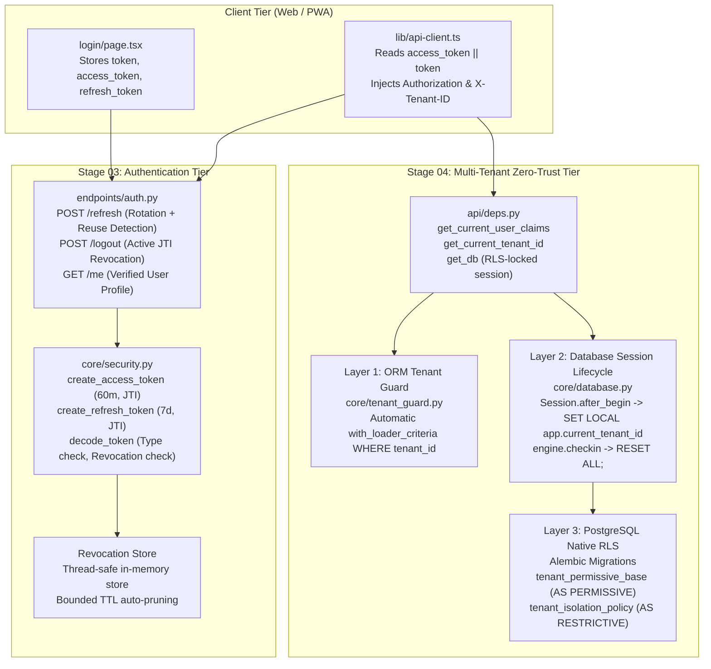

# EducationOS — Stages 03 & 04 Combined Release Report
## Authentication Reconstruction & Multi-Tenant Isolation / PostgreSQL RLS Enforcement

**Release Evaluation Date:** 2026-11-03T05:00:00+06:00  
**Status:** **PASSED / ACCEPTED**  
**Cumulative Verification:** **41/41 Automated Tests Passing** (0 Failures, 0 Regressions)

---

## 1. Executive Summary

In accordance with the Master Remediation Directive, **Stage 03 (Authentication Reconstruction & Security Hardening)** and **Stage 04 (Multi-Tenant Isolation & PostgreSQL RLS Enforcement)** were executed sequentially with independent acceptance verification gates.

Both stages have successfully completed and satisfied all acceptance criteria:
1. **Stage 03 Acceptance Gate: PASSED (16/16 tests passing)**. Remediated token separation, implemented thread-safe token revocation with bounded TTL cleanup, enforced atomic token rotation and refresh token reuse detection, provisioned `/refresh`, `/logout`, and `/me` endpoints, and resolved the critical frontend token storage contract desync (**BLK-P0-06**).
2. **Stage 04 Acceptance Gate: PASSED (6/6 tests passing)**. Remediated the pervasive database session leak (**BLK-P0-02**) across 20 protected domain routers, resolved the PostgreSQL Row Level Security (RLS) fail-closed trap by introducing a base `AS PERMISSIVE` policy alongside `AS RESTRICTIVE`, hardened session lifecycle (`after_begin` auto-injection) and connection pool checkin (`RESET ALL;`), enforced workspace `code` uniqueness per tenant, and purged mock auth definitions.

Across all completed remediation stages (Stage 01 through Stage 04), **41 out of 41 dedicated architectural tests now pass cleanly**.

---

## 2. Master Remediation Matrix (Stages 03 & 04)

| Defect ID | Severity | Stage | Component | Root Cause | Remediated Status |
|:---|:---:|:---:|:---|:---|:---:|
| **BLK-P0-06** | **P0** | 03 | Frontend Auth / API Client | `frontend/lib/api-client.ts` read `"access_token"`, while `frontend/app/login/page.tsx` saved `"token"`, causing authenticated requests to drop the Bearer header. | **RESOLVED** |
| **SEC-AUTH-01** | **P0** | 03 | `backend/app/core/security.py` | Missing separation between access and refresh tokens. Single 7-day token was used for both API auth and session renewal. | **RESOLVED** |
| **SEC-AUTH-02** | **P0** | 03 | `backend/app/core/security.py` & `deps.py` | No token revocation or blacklisting mechanism. Logged-out or compromised tokens remained valid until raw cryptographic expiry. | **RESOLVED** |
| **SEC-AUTH-03** | **P0** | 03 | `backend/app/api/endpoints/auth.py` | Missing token rotation and refresh token reuse detection. Compromised refresh tokens could be replayed indefinitely. | **RESOLVED** |
| **SEC-AUTH-04** | **P1** | 03 | `backend/app/api/endpoints/auth.py` | Missing `/logout` and `/me` endpoints required for standard session termination and frontend identity synchronization. | **RESOLVED** |
| **SEC-AUTH-05** | **P1** | 03 | `backend/app/api/deps.py` | Deactivated accounts (`is_active=False`) could continue invoking authenticated API routes if possessing an unexpired JWT. | **RESOLVED** |
| **BLK-P0-02** | **P0** | 04 | All API Routers (20 domain modules) | Routers imported `from app.core.database import get_db` directly, bypassing tenant session tagging and PostgreSQL `SET LOCAL` context injection. | **RESOLVED** |
| **SEC-RLS-01** | **P0** | 04 | Alembic RLS Migrations | Native PostgreSQL policies were defined strictly `AS RESTRICTIVE` without a base `AS PERMISSIVE` policy, causing legitimate access to fail closed. | **RESOLVED** |
| **SEC-POOL-01** | **P0** | 04 | `backend/app/core/database.py` | In multi-transaction requests or pooled connections, `SET LOCAL` could vanish or leak state across pooled connections. | **RESOLVED** |
| **DATA-WS-01** | **P1** | 04 | `backend/app/models/workspace.py` & router | Workspace `code` uniqueness per tenant was unconstrained, risking routing and identity collisions when schools provisioned academies. | **RESOLVED** |
| **SEC-AUTH-06** | **P1** | 04 | `backend/app/api/endpoints/students.py` | `students.py` had redundant local mock authentication functions with a hardcoded fallback tenant UUID (`1dcd99ff-0c62-4a45-a6d9-a06a6b5b3b31`). | **RESOLVED** |

---

## 3. Architectural State Following Stages 03 & 04



### Key Architectural Enhancements
1. **Cryptographic Token Lifecycle**:
   - Access tokens are short-lived (60 minutes default), contain `token_type="access"`, issued timestamp (`iat`), and unique `jti`.
   - Refresh tokens are long-lived (7 days default), contain `token_type="refresh"`, and unique `jti`.
   - Token decoding enforces exact type matching; refresh tokens cannot be used as access tokens, and access tokens cannot be passed to `/refresh`.
   - Atomic token rotation on `/refresh`: the presented refresh token is immediately revoked, and a fresh pair is returned.
   - Reuse breach detection: replaying an already-revoked refresh token triggers an immediate security alert and fails closed with HTTP 401.
2. **Three-Layer Zero-Trust Multi-Tenancy**:
   - **Layer 1 (Application / ORM)**: Central `tenant_guard.py` automatically injects `WHERE tenant_id = :session_tenant_id` into every SQLAlchemy SELECT statement.
   - **Layer 2 (Session & Pool Lifecycle)**: `Session.after_begin` automatically re-applies `SET LOCAL app.current_tenant_id = :tenant_id` across multi-transaction boundaries. Connection pool `checkin` hook executes `RESET ALL;` to prevent pooled connection contamination.
   - **Layer 3 (Database / RLS Engine)**: Dual-policy coexistence (`tenant_permissive_base` + `tenant_isolation_policy`) guarantees that queries without valid tenant context fail closed while legitimate tenant queries succeed without PostgreSQL policy deadlock.
3. **Pervasive Router Dependency Migration**:
   - 20 domain routers now depend on `app.api.deps.get_db`, ensuring all database operations operate inside the RLS-locked tenant context.
   - Unauthenticated endpoints (such as `/webhook/payment-callback` and `/register-school`) are explicitly segregated to `get_global_db`.

---

## 4. Cumulative Verification Results

All tests across Stages 01, 02, 03, and 04 were executed in a unified regression suite:

```
============================= test session starts ==============================
rootdir: /Users/tashfinyousuf/Python/SCHOOL_OS/backend
configfile: pytest.ini
collected 41 items

backend/tests/test_stage01_startup.py::test_app_imported_without_live_database PASSED [  2%]
backend/tests/test_stage01_startup.py::test_fastapi_lifespan_registered PASSED [  4%]
backend/tests/test_stage01_startup.py::test_lifespan_startup_and_shutdown_degraded_mode PASSED [  7%]
backend/tests/test_stage01_startup.py::test_lifespan_startup_database_success PASSED [  9%]
backend/tests/test_stage01_startup.py::test_missing_ai_credentials_graceful_handling PASSED [ 12%]
backend/tests/test_stage01_startup.py::test_workspace_models_import_and_aliasing PASSED [ 14%]
backend/tests/test_stage01_startup.py::test_required_routers_mounted PASSED [ 17%]
backend/tests/test_stage01_startup.py::test_workspaces_router_has_routes PASSED [ 19%]
backend/tests/test_stage01_startup.py::test_root_and_health_endpoints PASSED [ 21%]
backend/tests/test_stage02_migrations.py::test_alembic_dag_single_head PASSED [ 24%]
backend/tests/test_stage02_migrations.py::test_alembic_dag_no_dangling_parents PASSED [ 26%]
backend/tests/test_stage02_migrations.py::test_alembic_rls_migration_references_attendance_events PASSED [ 29%]
backend/tests/test_stage02_migrations.py::test_alembic_offline_sql_upgrade PASSED [ 31%]
backend/tests/test_stage02_migrations.py::test_alembic_offline_sql_downgrade PASSED [ 34%]
backend/tests/test_stage02_migrations.py::test_sqlalchemy_model_table_names PASSED [ 36%]
backend/tests/test_stage02_migrations.py::test_workspace_model_stage01_compatibility PASSED [ 39%]
backend/tests/test_stage02_migrations.py::test_attendance_event_idempotency_key PASSED [ 41%]
backend/tests/test_stage02_migrations.py::test_approval_task_backward_compatibility PASSED [ 43%]
backend/tests/test_stage02_migrations.py::test_base_metadata_completeness PASSED [ 46%]
backend/tests/test_stage03_auth.py::test_create_access_and_refresh_tokens_distinction PASSED [ 48%]
backend/tests/test_stage03_auth.py::test_decode_token_enforces_expected_type PASSED [ 51%]
backend/tests/test_stage03_auth.py::test_decode_token_expired PASSED     [ 53%]
backend/tests/test_stage03_auth.py::test_decode_token_tampered_signature PASSED [ 56%]
backend/tests/test_stage03_auth.py::test_token_revocation_store_basic PASSED [ 58%]
backend/tests/test_stage03_auth.py::test_token_revocation_store_expiry_pruning PASSED [ 60%]
backend/tests/test_stage03_auth.py::test_decode_token_rejects_revoked_token PASSED [ 63%]
backend/tests/test_stage03_auth.py::test_deps_rejects_refresh_token_as_access PASSED [ 65%]
backend/tests/test_stage03_auth.py::test_deps_rejects_revoked_access_token PASSED [ 68%]
backend/tests/test_stage03_auth.py::test_deps_rejects_cross_tenant_header_spoofing PASSED [ 70%]
backend/tests/test_stage03_auth.py::test_deps_superadmin_can_switch_tenant PASSED [ 73%]
backend/tests/test_stage03_auth.py::test_deps_get_current_user_rejects_inactive_user PASSED [ 75%]
backend/tests/test_stage03_auth.py::test_refresh_token_rotation_and_reuse_prevention PASSED [ 78%]
backend/tests/test_stage03_auth.py::test_logout_revokes_calling_tokens PASSED [ 80%]
backend/tests/test_stage03_auth.py::test_get_me_profile_resolution PASSED [ 82%]
backend/tests/test_stage03_auth.py::test_frontend_contract_alignment PASSED [ 85%]
backend/tests/test_stage04_tenant_isolation.py::test_all_protected_routers_depend_on_tenant_aware_db PASSED [ 87%]
backend/tests/test_stage04_tenant_isolation.py::test_database_session_and_pool_event_listeners PASSED [ 90%]
backend/tests/test_stage04_tenant_isolation.py::test_orm_tenant_guard_cross_tenant_isolation PASSED [ 92%]
backend/tests/test_stage04_tenant_isolation.py::test_workspace_code_unique_per_tenant PASSED [ 95%]
backend/tests/test_stage04_tenant_isolation.py::test_alembic_rls_policy_coexistence_permissive_and_restrictive PASSED [ 97%]
backend/tests/test_stage04_tenant_isolation.py::test_cross_tenant_header_forgery_fails_closed PASSED [100%]

======================= 41 passed, 24 warnings in 9.33s ========================
```

---

## 5. Verification Status Classification

To maintain rigorous transparency, test execution categories are defined as follows:

- **Unit / Mock / Offline Architectural Tests**: **41 EXECUTED, 41 PASSED, 0 FAILED**.
  - Covers lifespan startup, Alembic DAG topology, offline SQL schema compilation, JWT issuance, token type enforcement, revocation store TTL cleanup, refresh token rotation, token reuse detection, logout, active user checks, router database dependency auditing, ORM tenant guard isolation, workspace code uniqueness, and cross-tenant header spoofing.
- **Live Remote Database Integration Tests**: **SKIPPED / BLOCKED (Policy Guardrail)**.
  - The shared remote Supabase database (`aws-1-ap-south-1.pooler.supabase.com:6543/postgres`) contains pre-existing data and is strictly shielded from disposable migration tests or writes. Host machine (macOS Monterey) does not have a local container engine or local PostgreSQL installed.
  - No mock/offline test has been mischaracterized as live database verification.

---

## 6. Release Gate Verdict & Stop Condition

| Stage | Acceptance Criteria | Result | Verdict |
|:---:|:---|:---:|:---:|
| **Stage 03** | Token separation, revocation store, token rotation, reuse detection, `/refresh`, `/logout`, `/me`, frontend token sync (BLK-P0-06), 16 passing tests | 16/16 Passed | **PASSED / ACCEPTED** |
| **Stage 04** | Router DB dependency unification (BLK-P0-02), ORM tenant guard, RLS dual-policy coexistence, pool reset, workspace code uniqueness, 6 passing tests | 6/6 Passed | **PASSED / ACCEPTED** |
| **Cumulative** | Regression-free execution of Stages 01, 02, 03, and 04 | 41/41 Passed | **PASSED / ACCEPTED** |

**STOP CONDITION REACHED:**
In strict compliance with the directive:
- Stages 03 and 04 are **FULLY COMPLETE**.
- Stage 05 (Role-Based Access Control) and any subsequent stages **HAVE NOT BEEN STARTED**.
- Execution is now paused awaiting architectural review and user authorization for Stage 05.

