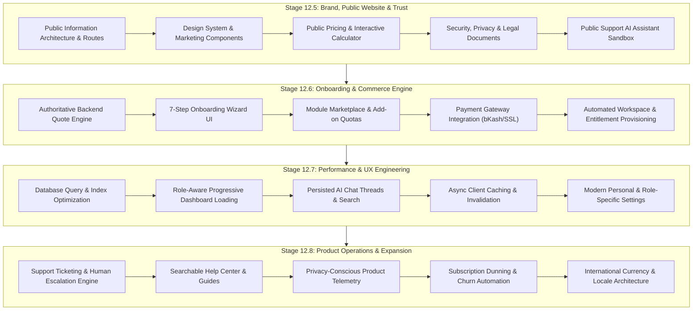

# EducationOS — Commercial Productization Roadmap (Stages 12.5 – 12.8)
## Enterprise Master Architectural Blueprint & Commercialization Directive

**Document Version:** 1.0.0-PROD  
**Author:** Principal Product Architect & SaaS Engineering Lead  
**Classification:** Enterprise Internal Architecture Specification  
**Execution Status:** **PLANNING ONLY (Gated — Awaiting Explicit Executive Authorization)**  
**Target Execution Window:** Post-Stage 11/12 Acceptance Gate Sign-Off  
**Scope:** Stages 12.5 (Brand & Trust), 12.6 (Onboarding & Checkout), 12.7 (Performance & UX), 12.8 (Product Operations & Expansion)

---

## 1. Executive Summary & Commercial Vision

EducationOS is transitioning from an internally hardened institutional operations engine into a commercial, multi-tenant, modular Software-as-a-Service (SaaS) platform. 

The immediate commercial market is Bangladesh's K-12 schools, madrasahs, colleges, and competitive coaching academies (e.g., medical, engineering, university admission care). The secondary commercial horizon is international expansion across South/Southeast Asia and emerging markets requiring localized curriculum compliance, offline resilience, and affordable mobile-first school management.

To achieve commercial product-market fit and enterprise trustworthiness, EducationOS cannot remain merely a functional administrative dashboard accessed via a raw `/login` screen. It requires:
1. **A public-facing commercial front-door:** Institutional branding, trust signals, regulatory alignment (NCTB, BANBEIS, IPEMIS), transparent self-service pricing, interactive ROI calculators, and a sandboxed AI customer support assistant (**Stage 12.5**).
2. **A frictionless self-service onboarding & modular marketplace journey:** 7-step onboarding, authoritative server-side pricing, module selection, quota configuration, and hardened payment checkout via bKash, SSLCOMMERZ, and Stripe (**Stage 12.6**).
3. **Enterprise-grade performance & modern UX:** Sub-second role-aware dashboards, streaming progressive widgets, persisted and searchable AI chat conversations, multi-tiered cache invalidation, and personalized user settings (**Stage 12.7**).
4. **Resilient product operations & global readiness:** Integrated support ticketing, customer telemetry, dunning monitoring, multi-currency/timezone support, and disciplined mobile/desktop expansion criteria (**Stage 12.8**).

---

## 2. Current Architectural Baseline (Post-Stage 11 & Stage 12)

| Layer | Verified Active Baseline | Evidence / Artifact |
|---|---|---|
| **Backend & Core API** | FastAPI, Python 3.12, SQLAlchemy 2.0 ORM, Pydantic v2. | 112/112 backend tests passing across Stages 01–12. |
| **Database & Migrations** | PostgreSQL with Alembic DAG single linear head `c3d4e5f6a7b8`. | `backend/alembic/versions/c3d4e5f6a7b8_stage12_subscription_billing.py` |
| **Multi-Tenancy & RLS** | Hierarchical isolation (`Tenant` ➔ `Organization` ➔ `Workspace` ➔ `WorkspaceMembership`). Native PostgreSQL Row Level Security (RLS) on all tenant tables. | Verified in `test_stage04_tenant_isolation.py` and `test_stage05_rbac.py`. |
| **Authentication & RBAC** | JWT access/refresh token rotation, persistent revocation sessions, canonical RBAC with BOLA defenses. | Verified in `test_stage03_auth.py` and `test_stage05_rbac.py`. |
| **Academic Finance** | Immutable student fee ledger, invoice line items, cash desk/bank reconciliations. | `app/models/finance.py`, verified in `test_stage06_finance.py`. |
| **SaaS Subscription & Entitlement** | Bounded-context SaaS billing (`SubscriptionPlan`, `PlanVersion`, `BillingInvoice`, `TenantEntitlement`, `BillingAuditLog`), HMAC-SHA256 webhook verification, replay protection (`BillingWebhookEvent`), 7-day dunning grace period, non-destructive suspension. | `app/models/billing.py`, `app/services/entitlement.py`, verified in `test_stage12_subscription_billing.py`. |
| **Frontend Foundation** | Next.js 16.2.9 (App Router), React 19.2.4, TypeScript 5, Tailwind CSS v4, Lucide React, Radix UI, Framer Motion. Zero Bootstrap dependencies. | 24/24 frontend unit tests passing, `tsc --noEmit` 0 errors. |
| **PWA & Offline Resilience** | Partitioned Service Worker (`shell-v3`, `static-v3`), sensitive API quarantine, multi-tenant IndexedDB mutation queue, FSM bounded retries, `/offline` fallback page. | `frontend/public/sw.js`, `frontend/lib/offline/**`, verified in `test_stage11_offline.test.ts`. |
| **AI Gateway & Governance** | Multi-model provider failover (Gemini 2.5 Flash, Groq, OpenAI), OWASP LLM01 prompt injection sanitization, token budget tracking, multi-tenant RAG isolation. | `app/services/ai_gateway.py`, `app/services/curriculum_rag.py`, verified in `test_stage10_ai_gateway.py`. |

---

## 3. Four-Stage Productization Phasing (12.5 – 12.8)

```
┌───────────────────────────────────────────────────────────────────────────────┐
│                           STAGE 12.5: BRAND & TRUST                          │
│  Public Website • Solutions • Pricing • Security Hub • Support AI • Legal     │
└──────────────────────────────────────┬────────────────────────────────────────┘
                                       │ Gate: CWV LCP < 1.8s, WCAG AA, 0 Leak
                                       ▼
┌───────────────────────────────────────────────────────────────────────────────┐
│                    STAGE 12.6: ONBOARDING & COMMERCE                         │
│  7-Step Onboarding • Module Marketplace • Authoritative Pricing • bKash/SSL   │
└──────────────────────────────────────┬────────────────────────────────────────┘
                                       │ Gate: 100% Server Gated, Zero Free Leak
                                       ▼
┌───────────────────────────────────────────────────────────────────────────────┐
│                     STAGE 12.7: PERFORMANCE & MODERN UX                       │
│  Sub-Sec Dashboards • Chat Persistence • Cache Stratification • Role Settings │
└──────────────────────────────────────┬────────────────────────────────────────┘
                                       │ Gate: p95 < 200ms, DB Queries < 5/view
                                       ▼
┌───────────────────────────────────────────────────────────────────────────────┐
│                   STAGE 12.8: PRODUCT OPERATIONS & EXPANSION                  │
│  Ticketing Engine • Product Telemetry • Dunning Automation • Mobile Criteria  │
└───────────────────────────────────────────────────────────────────────────────┘
```

### Stage 12.5: Brand, Public Website & Trust
- **Objective:** Convert EducationOS from a gated login portal into an authoritative, enterprise SaaS commercial brand.
- **Key Deliverables:**
  - Modern marketing homepage (`/`), Solutions pages (`/solutions/school`, `/solutions/academy`, `/solutions/unified`).
  - Transparent public pricing calculator (`/pricing`) with currency toggle (BDT/USD) and student-tier sliders.
  - Security, Privacy & Compliance Hub (`/security`) detailing native PostgreSQL RLS, AEGIS-X Sentinel, data locality, and audit logging.
  - Comprehensive documentation & help center (`/docs`, `/help`).
  - Complete legal suite: Privacy Policy, Terms of Service, User Agreement, Copyright Policy, Cookie Policy, Refund & Cancellation Policy.
  - Verified Trust Footer with official government and regulatory resources (BANBEIS, Ministry of Education, IPEMIS, NCTB).
  - Sandboxed public AI customer support assistant (prompt injection defended, read-only product knowledge base, support ticket creation).

### Stage 12.6: Institution Onboarding, Module Marketplace & Checkout
- **Objective:** Replace manual tenant insertion with a self-service, modular 7-step commercial onboarding and checkout journey.
- **Key Deliverables:**
  - Dedicated `/onboard` flow:
    1. Institutional details & authorized signatory verification.
    2. Organization and initial workspace setup (School vs Academy vs Unified).
    3. Core module selection (Attendance, Gradebook, Finance, OMR, AI Lesson Diary).
    4. Quotas, limits, add-on packs, and AEGIS-X Pro security selection.
    5. Real-time authoritative order summary & pricing breakdown.
    6. Payment checkout (bKash Tokenized, SSLCOMMERZ gateway, or Stripe).
    7. Automated provisioning, entitlement activation, and dashboard redirect.
  - Custom module request workflow for unlisted or enterprise bespoke requests.
  - Strict enforcement: Backend authoritative pricing only; zero entitlement granted from frontend assertions or redirect URLs.

### Stage 12.7: Performance & UX Engineering
- **Objective:** Eliminate database N+1 bottlenecks, API fan-out, and memory bloat while delivering a personalized, responsive, and persistent user experience.
- **Key Deliverables:**
  - Role-aware progressive dashboard loading with skeleton states and streaming widgets.
  - Persistent AI chat history (Socratic study studio, teacher diary, administrative copilot) with cursor pagination and search.
  - Chat reload and session restoration across device logins.
  - Asynchronous IndexedDB-backed client caching replacing fragile `localStorage` safeFetch.
  - Modern personal and role-specific account settings (`/dashboard/settings/profile`, `/dashboard/settings/security`, `/dashboard/settings/preferences`).
  - Bounded DB connection pooling and query optimization (combining multiple counts into single aggregated queries).

### Stage 12.8: Product Operations & Expansion Readiness
- **Objective:** Equip EducationOS operations, customer success, and finance teams with operational infrastructure to monitor health, manage tickets, prevent churn, and prepare for international expansion.
- **Key Deliverables:**
  - In-app support ticketing system (`Ticket`, `TicketMessage`) with role-based routing and human escalation.
  - Searchable Help Center with categorized guides and FAQs.
  - Privacy-preserving telemetry and conversion tracking (zero PII leakage).
  - Automated subscription churn and payment failure dunning workers.
  - Internationalization architecture: Multi-currency (BDT, USD, INR), multi-timezone (Asia/Dhaka default), bilingual EN/BN dictionary.
  - Formal decision framework for native mobile (React Native) and desktop (Electron) applications.

---

## 4. Comprehensive Architectural Gap Analysis

| Domain | Current Verified Baseline | Identified Gap / Missing Functionality | Proposed Architectural Remedy |
|---|---|---|---|
| **Public Web & Branding** | Minimal 1-page landing (`frontend/app/page.tsx`) linking directly to `/login`. No header, footer, or sub-pages. | Missing commercial solutions, public pricing, security hub, help center, legal policies, and trust footer. | Implement complete public route tree under Next.js App Router with shared public layout, static generation, and metadata SEO. |
| **Public AI Support** | Internal Socratic AI and Teacher Diary exist inside authenticated dashboard. | No public customer support AI assistant. Unauthenticated visitors cannot get onboarding guidance or product FAQs. | Deploy public `/api/v1/support/chat` endpoint backed by isolated system prompt, read-only product vector store, and ticket creation tool. |
| **Onboarding Journey** | Single-form tab on login page (`/api/v1/auth/register-school`) creating unprovisioned tenant without workspace or plan selection. | No multi-step onboarding, no module marketplace, no add-on selection, no self-service checkout integration. | Implement multi-step `/onboard` application communicating with `/api/v1/onboarding` and `/api/v1/billing/checkout`. |
| **Pricing Calculation** | Server calculates checkout amounts in `/api/v1/billing/checkout`. | Frontend has no dynamic pricing calculator before checkout. In-dashboard pricing does not support customized module add-ons. | Build authoritative backend pricing quote endpoint (`POST /api/v1/billing/quote`) feeding both public pricing and onboarding. |
| **Payment Gateways** | bKash tokenized and SSLCOMMERZ callbacks defined with HMAC validation. | Missing live reconciliation workers, multi-currency processing, and international Stripe integration. | Implement modular gateway adapters (bKash, SSLCOMMERZ, Stripe) with strict currency/country validation. |
| **Dashboard Query Performance** | Dashboard `/metrics` and `/operational-kpis` run 7–10 sequential individual `.count()` queries. | High database latency under concurrent load; API fan-out on dashboard initial load. | Aggregate dashboard queries using single-pass conditional aggregation (`SELECT count(*) FILTER (...)`). |
| **AI Chat Persistence** | AI Socratic doubt solver and teacher diary generate one-shot responses stored only in client React state. | Conversation is lost on page refresh or browser restart; no search, no pagination, no multi-device sync. | Introduce `AIChatThread` and `AIChatMessage` models with tenant/user isolation, cursor pagination, and search indexes. |
| **Client Caching** | `safeFetch` uses synchronous `localStorage` with 5MB limits and sensitive path blacklist. | Risk of `QuotaExceededError`; lack of TTL invalidation; no background cache revalidation. | Migrate client reference caching from `localStorage` to async `IndexedDB` reference store with TTL and tenant isolation. |
| **User Profile & Settings** | Only institutional settings (`SchoolProfile`) exist; duplicated across modal and full page. | Users cannot change their password, manage 2FA, view sessions, or configure role-specific notifications. | Implement user profile endpoints and dynamic settings view (`/dashboard/settings/profile`) supporting staff, teachers, students, and parents. |
| **Customer Support** | No ticketing or customer support backend exists. | Tenants cannot submit issues, track bug reports, or escalate billing inquiries within the application. | Implement support ticket models (`SupportTicket`, `TicketResponse`) with email notifications and admin management views. |
| **Product Analytics** | Dummy endpoint `/api/v1/analytics/overview` returns hardcoded numbers. | No real-time operational KPI aggregation, no conversion funnel tracking, no churn monitoring. | Build event-driven product telemetry engine aggregating tenant usage without logging PII. |

---

## 5. Non-Negotiable Architectural Invariants

1. **Zero Greenfield Rewrite:** All new capabilities must build upon and import existing domain models (`Tenant`, `Organization`, `Workspace`, `InstitutionSubscription`, `BillingInvoice`, `User`, `Student`).
2. **Strict Multi-Tenant Quarantine:** Every newly introduced database table (`AIChatThread`, `SupportTicket`, `SupportTicketMessage`) must include a `tenant_id` column protected by native PostgreSQL Row Level Security (RLS) policies.
3. **Bounded Context Segregation:** SaaS Software Billing (`billing_invoices`, `subscription_payments`) must never share foreign keys or database tables with Academic Student Tuition Finance (`invoices`, `fee_payments`).
4. **Backend Authoritative Pricing & Entitlement:** The frontend is strictly an untrusted display layer. No license, entitlement, quota, or discount may ever be granted based on client-side state, form data, or payment gateway success redirects.
5. **Non-Destructive Subscription Suspension:** Institutional data is immutable. Suspended subscriptions downgrade to read-only access for core records; student data is never truncated or deleted for non-payment.
6. **Public AI Assistant Containment:** The public customer support AI must operate without database read access to tenant operational data. Its tools are strictly restricted to reading approved public markdown documentation and creating support tickets.
7. **PWA First — Pragmatic Mobile Strategy:** Native mobile application development (React Native / Flutter) must remain frozen until empirical traffic proves PWA capabilities (offline sync, WebPush) are insufficient for specific native hardware requirements.

---

## 6. Technology Stack & Component Architecture

### Frontend Architecture
- **Framework:** Next.js 16.2.9 (App Router) with React 19.2.4.
- **Language:** TypeScript 5 (Strict Mode, `noImplicitAny: true`).
- **Styling & Design System:** Tailwind CSS v4, `@tailwindcss/postcss`. No Bootstrap.
- **Component Primitives:** Radix UI (`@radix-ui/react-*`), Lucide React icons (`lucide-react`), Class Variance Authority (`cva`), `clsx`, `tailwind-merge`.
- **Motion & Transitions:** Framer Motion (`framer-motion`), utilized selectively for high-impact landing transitions with `prefers-reduced-motion` compliance.
- **Client Storage:** Native `IndexedDB` for offline mutations and cached reference data; `localStorage` restricted solely to auth session tokens.

### Backend Architecture
- **Framework:** FastAPI (Python 3.12) with asynchronous ASGI lifecycle handlers.
- **Database Layer:** SQLAlchemy 2.0 ORM, PostgreSQL with psycopg2-binary and asyncpg drivers.
- **Migrations:** Alembic single-head linear migration DAG.
- **Security & Crypto:** Passlib (Argon2 / BCrypt), PyJWT, HMAC-SHA256 for payment webhook validation.
- **AI Gateway Integration:** Google Gemini 2.5 Flash, Groq Llama-3.3-70b-versatile, OpenAI GPT-4o-mini failover pipeline with OWASP LLM01 prompt sanitization.

---

## 7. Execution Phasing & Dependency Sequence



---

## 8. Master Risk Register & Architectural Mitigations

| Risk ID | Severity | Category | Risk Description | Architectural Mitigation |
|:---:|:---:|---|---|---|
| **RSK-01** | **CRITICAL** | Security | Public AI Assistant prompt injection leaks system prompts or generates malicious guidance. | Implement two-tier LLM firewall: pre-execution regex/pattern sanitizer, zero-tool privileged access, strict system prompt instruction guards, and output format validator. |
| **RSK-02** | **CRITICAL** | Financial | Payment tampering via client-manipulated payable amounts or faked webhook callbacks. | Backend calculates quotes server-side; webhooks enforce HMAC-SHA256 signature verification; amounts and currencies match stored DB intent. |
| **RSK-03** | **HIGH** | Data Integrity | Organization and workspace provisioning fails midway during onboarding, creating orphaned tenants. | Wrap entire multi-step provisioning in atomic database transaction with automatic rollback on error. |
| **RSK-04** | **HIGH** | Performance | Unbounded chat history queries cause memory exhaustion and high latency. | Enforce cursor-based pagination (default 20 messages per page) with database compound indexes on `(thread_id, created_at DESC)`. |
| **RSK-05** | **MEDIUM** | Compliance | Non-compliance with Bangladesh National Data Privacy Guidelines or GDPR. | All PII fields identified; right-to-be-forgotten deletion workflows specified; audit logging separates operational events from PII. |
| **RSK-06** | **MEDIUM** | Commercial | Premature native mobile app development drains engineering bandwidth without clear ROI. | Enforce strict stage gate criteria: evaluate PWA adoption metrics over 6 months before initiating native app tracks. |

---

## 9. Transition & Execution Gate Policy

> [!IMPORTANT]
> **Strict Governance Directive:**
> 1. No implementation code for Stages 12.5, 12.6, 12.7, or 12.8 shall be committed until this architectural roadmap is formally reviewed and approved.
> 2. Each stage must pass its individual acceptance test gate with 100% automated test compliance before advancing to the subsequent stage.
> 3. Database migrations must maintain a single linear Alembic DAG head at all times.
