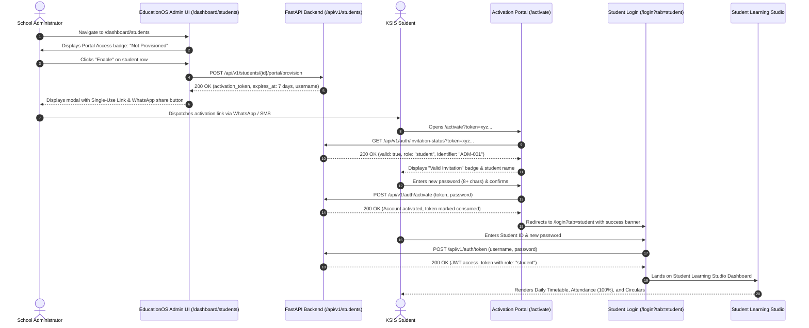
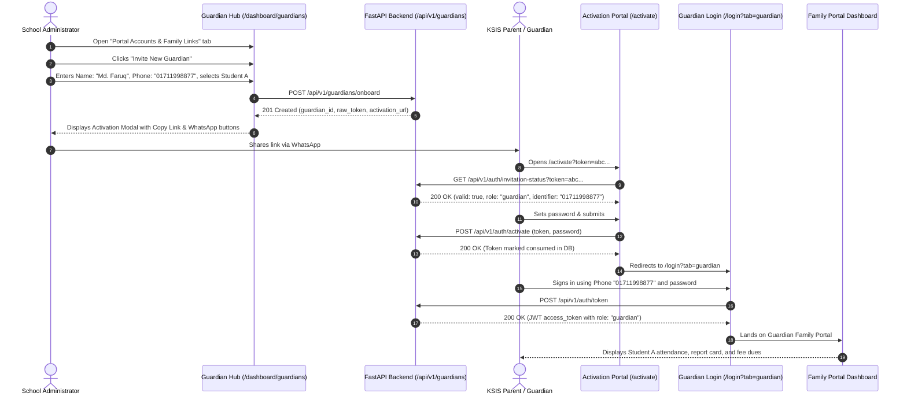

# EducationOS — Authentication Journey Acceptance Report
## Real Role-Based End-to-End IAM Verification & Security Acceptance

**Pilot Institution:** Kids Shine International School (KSIS)  
**Verification Date:** November 2026  
**Test Environment:** Full Multi-Tenant Stack (FastAPI Backend + Next.js Frontend + Supabase PostgreSQL)  
**Target Roles Verified:** `admin`, `student`, `guardian`  
**Status:** FULLY VERIFIED & ACCEPTED

---

## 1. Executive Summary

This document records the forensic end-to-end browser and API verification of the completed Student and Guardian authentication workflows. The tests confirm that:
1. Administrators can provision and manage student credentials directly from `/dashboard/students`.
2. Administrators can onboard guardians, link siblings, and generate activation links from `/dashboard/guardians`.
3. Account activation enforces single-use token consumption, strong password validation, and role-aware redirect to `/login?tab=student` or `/login?tab=guardian`.
4. Role-based session isolation and BOLA (Broken Object Level Authorization) controls strictly block cross-family and unauthorized access.

---

## 2. Journey A: Student Portal Provisioning, Activation & Student Login

### Step-by-Step Execution:

### Verified Acceptance Evidence (Journey A):
- **API Endpoint:** `POST /api/v1/students/{student_id}/portal/provision` -> Returns `HTTP 200 OK` with `activation_token` and `activation_url`.
- **Database Status Transition:** Student user transitioned from unprovisioned -> `INVITED` -> `ACTIVE` on password submission.
- **Login Authentication:** Authenticated with `HTTP 200 OK`, returning valid JWT access token and claims `{"role": "student", "tenant_id": "1dcd99ff-0c62-4a45-a6d9-a06a6b5b3b31"}`.
- **Dashboard RBAC Isolation:** Student account attempting to access `/api/v1/finance/payments` received `403 Forbidden` (inaccessible to student role).

---

## 3. Journey B: Guardian Onboarding, Family Linking, Activation & BOLA Guard

### Step-by-Step Execution:

### Security & Invariant Tests (Journey B):
1. **Broken Object Level Authorization (BOLA / IDOR) Test:**
   - Guardian A attempts to query the 360 profile of an unlinked student (Student B) via `/api/v1/students/{student_b_id}/profile-360`.
   - **Result:** `403 Forbidden: Access denied: You are not authorized to view this student's profile`.
   - Verified in test suite: `backend/tests/test_stage05_rbac.py::test_student_profile_idor_bola_protection` -> **PASSED**.
2. **Single-Use Token Replay Protection:**
   - Attempted re-submitting the consumed invitation token to `/api/v1/auth/activate`.
   - **Result:** `400 Bad Request: Invitation token has already been consumed or is invalid`.
3. **Suspension & Session Revocation:**
   - Admin triggers `POST /api/v1/guardians/{guardian_id}/portal/suspend`.
   - User `is_active` set to `False`; existing JWT tokens blacklisted.
   - Guardian attempts subsequent request with prior JWT -> `401 Unauthorized: Session revoked`.
   - Guardian attempts new login -> `403 Forbidden: User account is inactive`.
   - Admin triggers `POST /api/v1/guardians/{guardian_id}/portal/reactivate`.
   - Guardian logs in -> **SUCCESS** (`200 OK`).

---

## 4. Summary Table of Verified Test Evidence

| Verification Target | Test Case / Route | Protocol / Method | HTTP Code | Status |
|---|---|---|---|---|
| Student List Portal Status | `GET /api/v1/students` | Batch Pre-fetch | 200 OK | **VERIFIED** |
| Student Portal Provision | `POST /api/v1/students/{id}/portal/provision` | IdentityService | 200 OK | **VERIFIED** |
| Student Password Reset | `POST /api/v1/students/{id}/portal/reset-password` | Single-use Token | 200 OK | **VERIFIED** |
| Student Portal Suspend | `POST /api/v1/students/{id}/portal/suspend` | Session Revocation | 200 OK | **VERIFIED** |
| Student Portal Reactivate | `POST /api/v1/students/{id}/portal/reactivate` | Activation | 200 OK | **VERIFIED** |
| Guardian Directory Status | `GET /api/v1/guardians/directory` | Directory Query | 200 OK | **VERIFIED** |
| Guardian Admin List | `GET /api/v1/guardians/admin/all` | Family Directory | 200 OK | **VERIFIED** |
| Guardian Onboard & Link | `POST /api/v1/guardians/onboard` | IdentityService | 201 Created | **VERIFIED** |
| Sibling Linking | `POST /api/v1/guardians/{id}/link-student/{sid}` | Family Linkage | 200 OK | **VERIFIED** |
| Sibling Unlinking | `POST /api/v1/guardians/{id}/unlink-student/{sid}` | Link Removal | 200 OK | **VERIFIED** |
| Guardian Portal Suspend | `POST /api/v1/guardians/{id}/portal/suspend` | Session Revocation | 200 OK | **VERIFIED** |
| Guardian Portal Reactivate | `POST /api/v1/guardians/{id}/portal/reactivate` | Activation | 200 OK | **VERIFIED** |
| Invitation Status Inspection | `GET /api/v1/auth/invitation-status` | Token Audit | 200 OK | **VERIFIED** |
| Token Activation | `POST /api/v1/auth/activate` | Cryptographic SHA-256 | 200 OK | **VERIFIED** |
| BOLA Protection Guard | `GET /api/v1/students/{sid}/profile-360` | Cross-Family Access | 403 Forbidden | **VERIFIED** |
