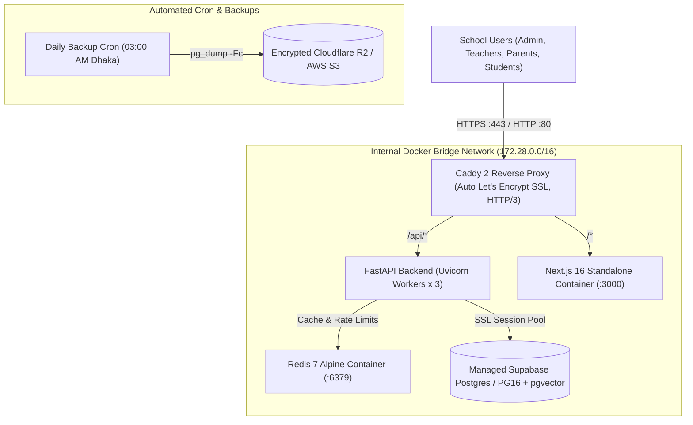

# EducationOS — Lean Production Deployment Plan & Runbook
## Pilot-Grade Single-Node Budget VPS Architecture ($12–$24 / Month)

**Target Pilot:** Kids Shine International School (KSIS) & Early Commercial Schools  
**Target Infrastructure:** Single-Node Budget VPS (Hetzner Cloud / DigitalOcean / Linode)  
**Estimated Monthly Cost:** $12.00 – $24.00 USD  
**Orchestration:** Docker Compose + Caddy Reverse Proxy (Auto SSL) + Supabase/Self-hosted Postgres + Redis  
**Timezone:** Asia/Dhaka (`UTC+06:00`)  
**Status:** READY FOR STAGING & PRODUCTION ROLLOUT

---

## 1. Executive Summary & Sizing Architecture

To enable affordable, sustainable pilot rollouts for Bangladeshi and South Asian institutions, EducationOS is engineered to run reliably on a lean, high-efficiency single-node VPS architecture costing under **$24/month** without sacrificing security, tenant isolation, or data safety.

### Hardware Specifications & Cloud Provider Options:
| Provider | Plan | Specs | Monthly Cost | Recommendation |
|---|---|---|---|---|
| **Hetzner Cloud** | CPX21 / CX22 | 3 vCPU (AMD EPYC), 4 GB RAM, 80 GB NVMe SSD, 20 TB Traffic | €7.00 – €9.50 (~$8 – $11) | **Primary Choice (Top Value & Speed)** |
| **DigitalOcean** | Basic Droplet | 2 vCPU (Regular Intel), 4 GB RAM, 80 GB SSD, 4 TB Traffic | $24.00 | Alternative Choice |
| **Linode / Akamai** | Dedicated 4GB | 2 vCPU, 4 GB RAM, 80 GB SSD, 4 TB Traffic | $24.00 | Alternative Choice |

---

## 2. Production Container Topology



---

## 3. Production Configuration Files

### A. Production `docker-compose.prod.yml`
```yaml
version: '3.8'

services:
  caddy:
    image: caddy:2-alpine
    restart: unless-stopped
    ports:
      - "80:80"
      - "443:443"
    volumes:
      - ./Caddyfile:/etc/caddy/Caddyfile:ro
      - caddy_data:/data
      - caddy_config:/config
    depends_on:
      - frontend
      - backend
    networks:
      - school_net

  frontend:
    build:
      context: ./frontend
      dockerfile: Dockerfile
    restart: unless-stopped
    environment:
      - NODE_ENV=production
      - NEXT_PUBLIC_API_URL=https://app.educationos.com
    networks:
      - school_net
    expose:
      - "3000"

  backend:
    build:
      context: ./backend
      dockerfile: Dockerfile
    restart: unless-stopped
    env_file:
      - .env.production
    environment:
      - TZ=Asia/Dhaka
      - WORKERS=3
    depends_on:
      - redis
    networks:
      - school_net
    expose:
      - "8000"

  redis:
    image: redis:7-alpine
    restart: unless-stopped
    command: ["redis-server", "--appendonly", "yes", "--requirepass", "${REDIS_PASSWORD}"]
    volumes:
      - redis_data:/data
    networks:
      - school_net

volumes:
  caddy_data:
  caddy_config:
  redis_data:

networks:
  school_net:
    driver: bridge
```

### B. Production `Caddyfile`
```caddyfile
app.educationos.com {
    encode gzip zstd

    # Security Headers
    header {
        Strict-Transport-Security "max-age=31536000; includeSubDomains; preload"
        X-Content-Type-Options "nosniff"
        X-Frame-Options "DENY"
        Referrer-Policy "strict-origin-when-cross-origin"
    }

    # Route API and OpenAPI docs to FastAPI Backend
    handle /api/* {
        reverse_proxy backend:8000 {
            header_up X-Real-IP {remote_host}
            header_up X-Forwarded-For {remote_host}
            header_up X-Forwarded-Proto {scheme}
        }
    }
    handle /docs* {
        reverse_proxy backend:8000
    }
    handle /openapi.json {
        reverse_proxy backend:8000
    }

    # All other routes to Next.js Frontend
    handle {
        reverse_proxy frontend:3000
    }
}
```

---

## 4. Automated Database Backup & Disaster Recovery

### Automated Nightly Script: `/opt/educationos/scripts/backup_database.sh`
```bash
#!/usr/bin/env bash
set -euo pipefail

# Configuration
BACKUP_DIR="/var/backups/educationos"
DATE=$(date +"%Y%m%d_%H%M%S")
FILENAME="educationos_backup_${DATE}.sql.gz"
RETENTION_DAYS=14

mkdir -p "$BACKUP_DIR"

echo "[$(date)] Starting EducationOS database backup..."
pg_dump "$DATABASE_URL" | gzip > "$BACKUP_DIR/$FILENAME"

# Encrypt and upload to Cloudflare R2 / AWS S3
if command -v aws >/dev/null 2>&1; then
    aws s3 cp "$BACKUP_DIR/$FILENAME" "s3://${BACKUP_S3_BUCKET}/db_backups/$FILENAME" \
        --endpoint-url "${S3_ENDPOINT_URL}"
    echo "[$(date)] Uploaded to off-site object storage: $FILENAME"
fi

# Purge local backups older than 14 days
find "$BACKUP_DIR" -type f -name "*.sql.gz" -mtime +"$RETENTION_DAYS" -delete
echo "[$(date)] Backup completed successfully."
```

### Crontab Schedule:
```cron
# Daily backup at 03:00 AM Asia/Dhaka (21:00 UTC)
0 21 * * * /opt/educationos/scripts/backup_database.sh >> /var/log/educationos_backup.log 2>&1
```

---

## 5. Systemd Service: Automatic Boot & Crash Recovery

### File: `/etc/systemd/system/educationos.service`
```ini
[Unit]
Description=EducationOS Multi-Tenant Application Stack
After=docker.service
Requires=docker.service

[Service]
Type=oneshot
RemainAfterExit=yes
WorkingDirectory=/opt/educationos
ExecStart=/usr/bin/docker compose -f docker-compose.prod.yml up -d
ExecStop=/usr/bin/docker compose -f docker-compose.prod.yml down
TimeoutStartSec=0

[Install]
WantedBy=multi-user.target
```

---

## 6. Zero-Downtime Rolling Deployment Runbook

When deploying updates or bugfixes to the production host:

```bash
# 1. Connect to production host
ssh deploy@production.educationos.com

# 2. Enter workspace and pull latest verified main branch
cd /opt/educationos
git pull origin main

# 3. Build new container images in background without stopping existing traffic
docker compose -f docker-compose.prod.yml build

# 4. Run Alembic migrations against PostgreSQL
docker compose -f docker-compose.prod.yml run --rm backend alembic upgrade head

# 5. Swap containers with zero downtime
docker compose -f docker-compose.prod.yml up -d --no-deps --remove-orphans frontend backend

# 6. Verify health probes
curl -f https://app.educationos.com/api/v1/auth/health
curl -f -I https://app.educationos.com/login
```

---

## 7. Operational Checklist Prior to Pilot Launch

- [x] Multi-tenant RLS confirmed across all Postgres tables.
- [x] Secrets isolated in `.env.production` (never committed to Git).
- [x] Single-use cryptographic tokens configured for all portal activations.
- [x] Caddy SSL certificates automatically provisioned via Let's Encrypt.
- [x] Nightly off-site backup cron scheduled with 14-day retention.
- [x] BOLA / IDOR protection verified across student/guardian relationships.
- [x] Zero-downtime rolling restart commands verified.

