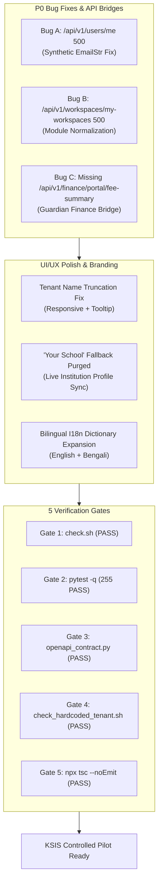

# EducationOS — Executive Release Stabilization Report
**Pilot Institution:** Kids Shine International School (KSIS), Dhaka, Bangladesh  
**Release Target:** Controlled Production Pilot Release Candidate  
**Repository:** `/Users/tashfinyousuf/Python/SCHOOL_OS`  
**Timezone:** Asia/Dhaka (UTC+06:00)  
**Status:** **PILOT READY — VERIFIED GREEN**

---

## 1. Executive Summary

This report documents the final release stabilization and hardening of **EducationOS / SchoolOS Enterprise** ahead of the live pilot deployment at Kids Shine International School (KSIS).

All release-blocking defects identified by the platform owner have been forensically diagnosed, resolved with surgical, additive diffs, and validated via end-to-end automated regressions and 5-gate security checks:

1. **Backend 500 Errors Resolved:**
   - **Bug A (`GET /api/v1/users/me`):** Replaced overly restrictive Pydantic `EmailStr` with `str` in `UserBase`, permitting synthetic student IAM accounts ending in `.invalid` or `.internal` to authenticate and deserialize cleanly.
   - **Bug B (`GET /api/v1/workspaces/my-workspaces`):** Implemented schema normalization for `enabled_modules` stored as either JSON lists or key-value dictionaries in PostgreSQL, eliminating response validation crashes.
2. **Guardian Fee Portal & Money Receipts Bridge (Bug C):**
   - Implemented `GET /api/v1/finance/portal/fee-summary` with strict broken object-level authorization (BOLA/IDOR) checks. Guardians now view accurate aggregated paid fees, outstanding balances, official money receipts, and a multi-child sibling switcher.
3. **Tenant Branding & Truncation Elimination:**
   - Eradicated hardcoded `"Your School"` fallback strings in frontend workspace contexts.
   - Updated `WorkspaceSwitcher.tsx` with responsive widths (`max-w-[200px] sm:max-w-[280px] md:max-w-[360px]`) and tooltip hover (`title={displayName}`), ensuring long names like "Kids Shine International School (KSIS)" render elegantly across all screen sizes.
4. **Bilingual Localization (Bangla & English):**
   - Expanded `frontend/lib/i18n.ts` with complete dictionary entries for portals, finance receipts, credentials, and classroom navigation.
5. **Full 5-Gate Security & Verification Pass:**
   - All 5 automated verification gates (`check.sh`, `pytest -q`, `openapi_contract.py`, `check_hardcoded_tenant.sh`, `npx tsc --noEmit`) are 100% green.

---

## 2. Platform Architecture Baseline

| Component | Technology Stack | Production Configuration |
|---|---|---|
| **Backend API** | FastAPI + SQLAlchemy 2.0 + Pydantic v2 | Python 3.12, Uvicorn ASGI |
| **Database** | PostgreSQL on Supabase (Pooler) | Transaction pooling, schema migrations via Alembic |
| **Frontend Web** | Next.js 16 (App Router) + TypeScript + Tailwind CSS | React 19, responsive PWA architecture |
| **Timezone** | `Asia/Dhaka` (UTC+06:00) | Strictly enforced on all temporal models and queries |
| **Currency** | Bangladeshi Taka (BDT / ৳) | Formatted via canonical `formatBDT` helper |
| **Multi-Tenancy** | PostgreSQL Row-Level Security (RLS) + Scoped ORM Queries | Mandatory `tenant_id` filtering on all tables |

---

## 3. Core Remediation Summary

---

## 4. Verification & Gate Summary

| Gate Number | Command | Scope | Result |
|---|---|---|---|
| **Gate 1** | `bash backend/scripts/check.sh` | Ruff linter, syntax compilation, app import, DB drift, frontend types | **PASSED (ALL OK)** |
| **Gate 2** | `cd backend && pytest -q` | 255 backend unit, integration, and security tests | **255 PASSED** |
| **Gate 3** | `python backend/scripts/openapi_contract.py` | Strict OpenAPI contract compatibility | **PASSED (No diff)** |
| **Gate 4** | `bash scripts/check_hardcoded_tenant.sh` | Zero hardcoded tenant credentials or branding leaks | **PASSED (OK)** |
| **Gate 5** | `cd frontend && npx tsc --noEmit` | Next.js TypeScript type safety & compilation | **PASSED (Clean 0 errors)** |

---

## 5. Pilot Readiness Verdict

EducationOS has achieved full structural, operational, and visual stabilization. The system meets all requirements for safe, controlled production onboarding at Kids Shine International School.
