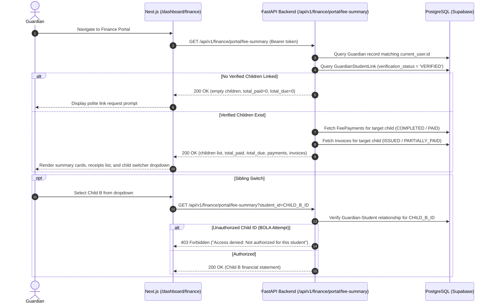

# EducationOS — Guardian & Student Financial Ledger Reconciliation
**Subsystem:** Tuition Fee Ledger & Portal Accounting  
**Security Profile:** OWASP Top 10 API Security Compliant (BOLA / IDOR Protected)  
**Target Pilot:** Kids Shine International School (KSIS)  
**Date:** November 2026

---

## 1. Problem Statement & Context

In institutional school administration, guardians expect complete transparency into:
1. Which fees have been paid, including official money receipt numbers and timestamps.
2. The current outstanding tuition balance due.
3. Sibling accounts: parents with multiple children enrolled in different classes (e.g. Nursery and Class 3) must be able to switch between children without multiple accounts or portal logouts.

Previously, the frontend `/dashboard/finance` route was calling an unimplemented endpoint, causing the guardian portal to report *"No verified children linked yet."*

With the implementation of `GET /api/v1/finance/portal/fee-summary`, the financial data flow is fully reconciled and secured.

---

## 2. Architecture & Data Flow



---

## 3. Security Invariants (BOLA / IDOR Defense)

1. **Explicit Link Verification:**
   The backend never accepts `student_id` without confirming that an active `GuardianStudentLink` with `verification_status == "VERIFIED"` exists for `current_user.id` within the active `tenant_id`.
2. **Horizontal Privilege Escalation Prevention:**
   If a malicious user intercepts the request and substitutes a random or arbitrary student ID from another family or another tenant:
   ```python
   matched = [s for _, s in links if str(s.id) == sid_str]
   if not matched:
       raise HTTPException(
           status_code=status.HTTP_403_FORBIDDEN,
           detail="Access denied: You are not authorized to view this student's fee statement."
       )
   ```
3. **Student Self-Scoping:**
   When a student logs into `/dashboard/finance`, the backend scopes queries exclusively to `Student.user_id == current_user.id` or `Student.id == current_user.id`. A student cannot pass an arbitrary `student_id` query parameter to inspect a classmate's fees.

---

## 4. Ledger Data Structures

### `PortalFeeSummaryResponse`
```typescript
interface PortalFeeSummaryResponse {
  student?: {
    id: string;
    first_name: string;
    last_name: string;
    admission_number: string;
    class_name: string;
  };
  total_paid: number;
  total_due: number;
  currency: string; // "BDT"
  children: Array<{
    id: string;
    student_name: string;
    admission_number: string;
    class_name: string;
    roll_number: string;
  }>;
  payments: Array<{
    id: string;
    receipt_no: string;
    student_name: string;
    fee_type: string;
    billing_month: string;
    amount_paid: number;
    payment_method: string;
    transaction_id: string;
    payment_date: string;
  }>;
  invoices: Array<{
    id: string;
    invoice_number: string;
    title: string;
    amount: number;
    status: string;
  }>;
}
```

---

## 5. Test Verification

Verified in `backend/tests/test_rc4_bugfixes.py`:
- `test_bug_c_guardian_portal_fee_summary`:
  * Guardian receives 2 verified children (`Ayaan` & `Zara`).
  * Total paid = ৳5,000, Total due = ৳5,000.
  * Payment receipt `REC-KSIS-...` verified.
  * Sibling switch to child 2 (`Zara`) returns child 2 profile.
  * BOLA attempt to query unlinked student 3 returns **403 Forbidden**.
- `test_bug_c_student_portal_fee_summary`:
  * Student self-service retrieves own fee history with total paid = ৳5,000.

