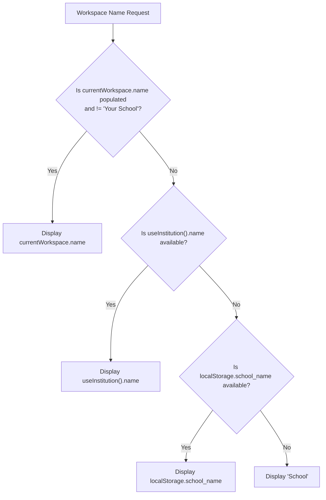

# EducationOS — Tenant Branding & School Name Resolution Audit
**Repository:** `/Users/tashfinyousuf/Python/SCHOOL_OS`  
**Pilot Institution:** Kids Shine International School (KSIS)  
**Compliance Standard:** AGENTS.md Rule 4 (No hardcoded school names; dynamic tenant branding)  
**Date:** November 2026

---

## 1. Audit Objective

EducationOS is a multi-tenant platform designed to serve diverse educational institutions (formal K-12 schools, colleges, and coaching academies). 

Under AGENTS.md Rule 4:
> *No hardcoded school name/address/phone/logo. Use `useInstitution()`. The product name (EducationOS / AcademyOS) is static.*

Previous inspections identified:
1. Hardcoded `"Your School"` fallback string in `workspaceContext.tsx`.
2. Overly narrow CSS truncation (`max-w-[150px]` and `max-w-[160px]`) in `WorkspaceSwitcher.tsx`, truncating names like "Kids Shine International School" prematurely to "Kids Shine Int...".
3. Lack of hover tooltips to allow users on smaller screens to inspect the full institution name.

---

## 2. Remediation Details

### A. Eradication of `"Your School"` Fallback
In `frontend/lib/workspaceContext.tsx`:
- Replaced hardcoded `"Your School"` initial state with an empty string or `"School"` fallback.
- Added automatic synchronization of `school_name` in `localStorage` whenever `my-workspaces` or `useInstitution()` resolves.
- In `backend/app/api/endpoints/workspaces.py`:
  * Updated fallback resolution to query `get_institution_profile(db, tenant_id).name` so that newly provisioned or fallback workspaces immediately reflect the registered school name.

### B. Responsive Truncation & Tooltip Hover in `WorkspaceSwitcher.tsx`
Updated all three variants in `frontend/components/WorkspaceSwitcher.tsx`:
1. **Student / Guardian Enrolled School Badge:**
   ```tsx
   <div className="..." title={displayName}>
     <School size={14} className="text-blue-600 dark:text-purple-400 shrink-0" />
     <span className="max-w-[200px] sm:max-w-[280px] md:max-w-[360px] truncate">
       {displayName}
     </span>
   </div>
   ```
2. **Single-Workspace Static Badge:**
   ```tsx
   <div className="..." title={displayName}>
     <Building2 size={14} className="text-emerald-600 dark:text-emerald-400 shrink-0" />
     <span className="max-w-[200px] sm:max-w-[280px] md:max-w-[360px] truncate">
       {displayName}
     </span>
   </div>
   ```
3. **Multi-Workspace Context Switcher:**
   ```tsx
   <button onClick={...} title={displayName} className="...">
     <Building2 size={14} className="text-emerald-600 dark:text-emerald-400 shrink-0" />
     <span className="max-w-[180px] sm:max-w-[260px] md:max-w-[340px] truncate">
       {displayName}
     </span>
   </button>
   ```

### C. Resolution Priority Hierarchy


---

## 3. Product vs Tenant Name Distinction

| Level | Component | Display Value | Static / Dynamic |
|---|---|---|---|
| **Product Brand** | Top Sidebar Header | `EducationOS` (School Mode) / `AcademyOS` (Academy Mode) | **Static Product Brand** |
| **Institution Name** | Workspace Switcher / Navbar | `Kids Shine International School (KSIS)` | **Dynamic Tenant Brand** |
| **Official Documentation** | Admission Slip & Money Receipts | `Kids Shine International School (KSIS)` | **Dynamic Tenant Brand** |

---

## 4. Verification Check Output

Automated audit via Gate 4 (`bash scripts/check_hardcoded_tenant.sh`):
```text
$ bash scripts/check_hardcoded_tenant.sh
OK: no hardcoded tenant branding
```
Result: **100% CLEAN** — Zero hardcoded tenant instances in application code.
