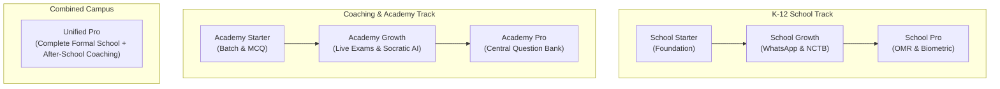

# EDUCATIONOS — PACKAGES, MODULES & COMMERCIAL ARCHITECTURE
## Transparent Pricing Formula, Feature Entitlements & Lifecycle Governance

**Document Version:** 2026.1-COMMERCIAL  
**Classification:** Institutional Pricing Guide & Plan Comparison  
**Pricing Engine Reference:** `backend/app/services/pricing_engine.py` & `backend/app/services/entitlement.py`  

---

## 1. Executive Commercial Philosophy: Predictable & Fair

Traditional school software vendors often lock institutions into opaque annual contracts with hidden implementation costs, unexpected per-user licensing fees, or predatory data-export charges.

**EducationOS is built on radical pricing transparency:**
1. **Zero Setup or Implementation Hidden Fees:** Standard onboarding, self-service data import, and workspace provisioning incur no hidden setup tax.
2. **Transparent Dynamic Pricing Formula:** Base infrastructure + graduated per-student charges + only the specialized modules you actually activate.
3. **Non-Destructive Account Lifecycle:** If an institution experiences payment delays or budget freezes, data is **never destroyed**. The system transitions to an automated 7-day grace period, followed by a non-destructive read-only state.
4. **Data Portability Guarantee:** You can export complete student directories, attendance records, and financial ledgers via CSV/Excel at any time, under any plan tier.

---

## 2. Dynamic Pricing Architecture & Mathematical Formula

EducationOS uses an authoritative, single-source-of-truth pricing engine (`PricingEngine`) that calculates billing precisely using fixed-precision Decimal arithmetic.

### 2.1 The Core Pricing Formula

$$\text{Monthly Total (BDT)} = \text{Base Fee} + \text{Tiered Student Charge} + \sum \text{Optional Modules} + \sum \text{Add-ons}$$

$$\text{Annual Net (BDT)} = (\text{Monthly Total} \times 12) \times (1 - 0.15)$$

*(An upfront annual subscription receives an automatic 15% discount across base platform, student capacity, and modules).*

### 2.2 Base Platform Infrastructure Fee
- **1,500 BDT / month**
- **What it covers:** Multi-tenant PostgreSQL database engine with Native RLS isolation, encrypted cloud object storage for student files, automated daily backups, secure PWA offline synchronization, and all **9 Core Platform Modules**.

### 2.3 Graduated Tiered Active Student Rates
Instead of a flat punitive rate, EducationOS uses a graduated student volume tier where per-student cost decreases as your institution grows:

| Student Volume Tier | Active Student Range | Rate per Active Student / Month |
| :--- | :--- | :--- |
| **Tier 1 (Base Capacity)** | 1 to 300 students | **12.00 BDT** |
| **Tier 2 (Growth Capacity)** | 301 to 800 students | **10.00 BDT** |
| **Tier 3 (Enterprise Scale)** | 801+ students | **8.00 BDT** |

*Graduated Calculation Example (500 Students):*
- First 300 students @ 12 BDT = 3,600 BDT
- Next 200 students @ 10 BDT = 2,000 BDT
- Total Student Charge = 5,600 BDT / month.

---

## 3. Core Modules Included in Base Platform Fee (0 BDT)

Every EducationOS subscription includes the complete operational foundation of an educational institution at zero additional cost:

| Module Identifier | Module Name | Operational Capabilities |
| :--- | :--- | :--- |
| `core_admin` | **Institution Administration** | Multi-role RBAC (Owner, Principal, Accountant, Teacher, Student, Parent), academic calendar, sessions, campus configuration. |
| `core_students` | **Student Directory & Digital Twin** | Student 360 profile, enrollment records, guardian links, emergency contacts, CSV roster bulk import. |
| `core_teachers` | **Teacher & Staff Management** | Staff directory, class teacher assignments, subject mapping, period routines. |
| `core_guardians` | **Guardian / Parent Portal** | Multi-child linked dashboard, live attendance status, exam results, and fee receipts. |
| `core_academic` | **Academic Structure & Routines** | Shift management (Morning/Day), classes, sections, subjects, periods, weekly timetable generator. |
| `core_attendance` | **Smart Attendance & Offline PWA** | 1-tap fast roll call, IndexedDB offline resilience, CSV export, printable A4 absentee register. |
| `core_exams` | **Examinations & Grading Registry** | Exam schedules, mark entry sheets, NCTB/GPA calculation, automated student report card generation. |
| `core_notices` | **Notices & Notice Board** | Category-tagged institutional notice board, audience targeting, document attachments. |
| `core_reports` | **Standard Operational Reports** | Class-wise attendance percentages, absentee trends, and student count summaries. |

---

## 4. Optional Specialization Modules

Institutions can activate specialized operational capabilities on-demand:

| Module Identifier | Module Name | Monthly Price (BDT) | Core Capabilities |
| :--- | :--- | :---: | :--- |
| `module_ai_assistant` | **AI Academic Copilot & RAG** | **1,200 BDT** | Multi-Model AI Gateway (Gemini primary + Groq failover), NCTB curriculum RAG search, bilingual question paper composer, 250,000 monthly AI tokens included. |
| `module_advanced_finance` | **Advanced Finance & Fee Engine** | **800 BDT** | Student fee structure builder, dual-copy student/school printed receipts, discount/waiver governance, multi-channel payment reconciliation (Cash, bKash, Bank). |
| `module_school_website` | **Hosted Public Web Portal** | **1,000 BDT** | SEO-optimized modern public school website with about section, principal's message, online admission inquiry form, notices, and image gallery. |
| `module_custom_domain` | **Custom Domain & SSL Mapping** | **500 BDT** | Automated DNS routing to institutional domain (e.g., `www.school.edu.bd`) with automated TLS/SSL certificate provisioning and renewal. |
| `module_whatsapp_alerts` | **Automated WhatsApp Absentee Alerts**| **600 BDT** | Immediate automated WhatsApp notification to parent phones when a student is marked absent during morning roll call. |

### 4.1 On-Demand Usage Add-ons
- **SMS Communication Pack (500 Credits):** 175 BDT (0.35 BDT / SMS).
- **AI Intelligence Quota Boost (500,000 Tokens):** 250 BDT.

---

## 5. Curated Plan Packages (By Institution Type)

For institutions preferring a pre-packaged tier over custom component selection, EducationOS provides structured packages optimized for Schools and Academies:

### 5.1 School Track Comparison

| Feature Capability | Free Trial (14 Days) | School Starter | School Growth | School Pro |
| :--- | :---: | :---: | :---: | :---: |
| **Active Student Capacity** | 100 | Up to 300 | Up to 800 | Unlimited |
| **Base Core Platform Modules** | Included | Included | Included | Included |
| **Attendance & PWA Offline Sync** | Yes | Yes | Yes | Yes |
| **Fee Receipts & Ledger** | Basic | Yes | Advanced | Advanced |
| **Automated Report Cards** | Yes | Yes | Yes | Yes |
| **NCTB Structured Grading** | — | — | **Yes** | **Yes** |
| **WhatsApp Absentee Alerts** | — | — | **Yes** | **Yes** |
| **Teacher Daily Lesson Diary** | — | — | **Yes** | **Yes** |
| **AI Question Paper Generator** | 50 Q/mo | 100 Q/mo | 300 Q/mo | Unlimited |
| **OMR Sheet Evaluation** | — | — | — | **Yes** |
| **Multi-Branch Campus Management**| — | — | — | **Yes** |
| **Biometric Attendance Hardware API**| — | — | — | **Yes** |
| **Immutable Audit Log Ledger** | — | — | — | **Yes** |

### 5.2 Academy & Coaching Track Comparison

| Feature Capability | Academy Starter | Academy Growth | Academy Pro |
| :--- | :---: | :---: | :---: |
| **Flexible Batch Management** | Yes | Yes | Yes |
| **MCQ Practice Engine** | Yes | Yes | Yes |
| **Negative Marking Rules** | Yes | Yes | Yes |
| **Batch Merit Lists & Percentiles** | Yes | Yes | Yes |
| **Live Timed Exams & Instant Scores**| — | **Yes** | **Yes** |
| **Socratic AI Tutor & Hints** | — | **Yes** | **Yes** |
| **Step-by-Step Solution Sheets** | — | **Yes** | **Yes** |
| **Automated Batch Due Alerts** | — | **Yes** | **Yes** |
| **Central Question Bank & Tagging** | — | — | **Yes** |
| **Student Performance Heatmap** | — | — | **Yes** |
| **Dedicated OMR Batch Processing** | — | — | **Yes** |

---

## 6. Subscription Lifecycle & Dunning Governance

EducationOS enforces ethical, predictable subscription state transitions (`EntitlementService`):

| Lifecycle State | Trigger Condition | System Behavior | Data Impact |
| :--- | :--- | :--- | :--- |
| `ACTIVE` | Paid subscription in good standing. | 100% full access to all entitled modules and quotas. | Full read/write. |
| `PAST_DUE` | Subscription expiration reached without renewal. | 24-hour notification banner shown to Administrators. | Full read/write preserved. |
| `GRACE_PERIOD` | Days 1 through 7 post-expiration. | System remains operational. Daily renewal reminders displayed to Principal. | Full read/write preserved. |
| `SUSPENDED` | Day 8 post-expiration without payment. | **Non-Destructive Read-Only Mode.** Staff can view and export student records and report cards. Edits blocked. | **Zero Data Deletion.** |
| `CANCELLED` | Explicit institutional termination request. | Data preserved for 90 days. Full institutional database export delivered to Owner. | Secure scheduled purge after archive delivery. |

> [!IMPORTANT]
> **Our Non-Destructive Guarantee:** EducationOS will never drop a school's database tables or lock staff out of exporting their historical academic archives during subscription disputes. Education continuity is protected.

