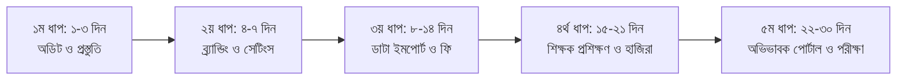

# এডুকেশনওএস — প্রাতিষ্ঠানিক অনবোর্ডিং ও বাস্তবায়ন প্লেবুক
## ৩০ দিনের পর্যায়ক্রমিক রূপান্তর রূপরেখা, পরিবর্তন ব্যবস্থাপনা ও পরিচালন প্রস্তুতি

**ডকুমেন্ট সংস্করণ:** 2026.1-ONBOARD  
**শ্রেণিবিভাগ:** প্রাতিষ্ঠানিক সফটওয়্যার বাস্তবায়ন ও কাস্টমার সাকসেস গাইড  
**উদ্দিষ্ট পাঠক:** অধ্যক্ষ, পরিচালনা পর্ষদ সদস্য, একাডেমিক কো-অর্ডিনেটর ও আইটি দায়িত্বপ্রাপ্ত শিক্ষক  

---

## ১. প্রাতিষ্ঠানিক বাস্তবায়ন দর্শন: ধাপে ধাপে সহজ রূপান্তর

একটি শিক্ষা প্রতিষ্ঠানে নতুন সফটওয়্যার সফলভাবে বাস্তবায়ন করা কোনো প্রযুক্তিগত জটিলতা নয়; এটি মূলত **অভ্যাস ও মানসিকতার পরিবর্তন ব্যবস্থাপনা (Change Management)**।

শিক্ষকদের ওপর যদি শুরুতেই জটিল ডেটা এন্ট্রির অতিরিক্ত বোঝা চাপিয়ে দেওয়া হয় কিংবা অভিভাবকরা যদি অ্যাপ ব্যবহারে বিভ্রান্ত হন, তবে যত আধুনিক প্রযুক্তিই হোক না কেন তা প্রতিষ্ঠানে কার্যকর হয় না।

**এডুকেশনওএস চারটি স্তম্ভের ওপর ভিত্তি করে সফল অনবোর্ডিং নিশ্চিত করে:**
১. **একদিনে সব পরিবর্তনের চাপ নয়:** আমরা ৩০ দিনে ৫টি সুশৃঙ্খল ও ঝুঁকিমুক্ত ধাপে সফটওয়্যার চালু করি।  
২. **প্যারালাল রান গ্যারান্টি (সমান্তরাল খাতা পরিচালনা):** ৩য় সপ্তাহে ডিজিটাল হাজিরার পাশাপাশি পূর্বের কাগুজে রেজিস্টারও চলমান থাকে, যাতে কোনো ঝুঁকি তৈরি না হয়।  
৩. **শিক্ষকদের জন্য অত্যন্ত সহজ ১-ট্যাপ মোবাইল পিডব্লিউএ:** শিক্ষকদের ভারী কম্পিউটার প্রয়োজন নেই; স্মার্টফোনে ইন্টারনেট সংযোগ ছাড়াও অফলাইনে সহজে হাজিরা নেওয়া যায়।  
৪. **স্কুলের অভ্যন্তরীণ একজন দায়িত্বপ্রাপ্ত প্রতিনিধি (Champion):** স্কুলের একজন উদ্যমী শিক্ষক বা কর্মকর্তাকে প্রশিক্ষণ দিয়ে দক্ষ করে তোলা হয়, যিনি সহকর্মীদের সার্বক্ষণিক সহায়তা প্রদান করেন।

---

## ২. ৩০ দিনের প্রাতিষ্ঠানিক রোডম্যাপ

---

### ১ম ধাপ: প্রাথমিক অডিট, সমন্বয় ও নেতৃত্ব নির্ধারণ (দিন ১ থেকে ৩)

**উদ্দেশ্য:** স্কুলের বর্তমান অ্যাকাডেমিক ও প্রশাসনিক কাঠামো পর্যালোচনা এবং প্রজেক্টের দায়িত্ব বণ্টন।

- **পদক্ষেপ ১.১ — প্রজেক্ট স্টিয়ারিং কমিটি গঠন:**
  - নির্বাহী পৃষ্ঠপোষক: স্কুলের অধ্যক্ষ বা গভর্নিং বডির সভাপতি।
  - প্রজেক্ট লিড: প্রধান প্রশাসনিক কর্মকর্তা বা সিনিয়র আইটি শিক্ষক।
  - শিক্ষক প্রতিনিধি: অভিজ্ঞ ও জনপ্রিয় একজন শিক্ষক যিনি অন্যান্য শিক্ষকদের সুবিধা-অসুবিধা তুলে ধরবেন।
- **পদক্ষেপ ১.২ — ডেটা অডিট ও তথ্য সংগ্রহ:**
  - বর্তমান শিক্ষার্থী রেজিস্টার খাতা বা এক্সেল শিট সংগ্রহ।
  - শ্রেণিভিত্তিক ফি তালিকা, টিউশন ফি, ছাড় বা স্কলারশিপের তালিকা সংগ্রহ।
  - পরীক্ষার গ্রেডিং নিয়ম ও পাস মার্ক সংক্রান্ত নীতিমালা সংগ্রহ।
- **ফলাফল:** অনবোর্ডিং তথ্য সংগ্রহ ও চেকলিস্টের আনুষ্ঠানিক অনুমোদন।

---

### ২য় ধাপ: টেন্যান্ট চালু, প্রাতিষ্ঠানিক ব্র্যান্ডিং ও কাঠামো (দিন ৪ থেকে ৭)

**উদ্দেশ্য:** স্কুলের নিজস্ব ডিজিটাল ক্যাম্পাস প্রস্তুতকরণ ও অ্যাডমিন নিরাপত্তা কনফিগারেশন।

- **পদক্ষেপ ২.১ — স্কুলের নিজস্ব ডিজিটাল ক্যাম্পাস সক্রিয়করণ:**
  - কাস্টম সাবডোমেইন বা ওয়েব অ্যাড্রেস প্রস্তুত (যেমন: `portal.schoolname.edu.bd`)।
  - প্রাতিষ্ঠানিক পরিচয় যুক্তকরণ: স্কুলের লোগো, অফিসিয়াল ঠিকানা, ফোন নম্বর ও মূলমন্ত্র (Motto)।
- **পদক্ষেপ ২.২ — একাডেমিক কাঠামো তৈরি:**
  - শিফট নির্ধারণ: মর্নিং শিফট বা ডে শিফট।
  - শ্রেণি ও শাখা তৈরি: যেমন প্রথম শ্রেণি (শাখা ক), প্রথম শ্রেণি (শাখা খ)।
  - বিষয় তালিকা প্রস্তুত ও শ্রেণিতে ম্যাপিং (বাংলা, ইংরেজি, গণিত, বিজ্ঞান ইত্যাদি)।
- **পদক্ষেপ ২.৩ — নিরাপত্তা ও কর্মকর্তা অ্যাকাউন্ট তৈরি:**
  - প্রিন্সিপাল, ভাইস প্রিন্সিপাল ও হিসাবরক্ষকদের অ্যাকাউন্ট তৈরি।
  - প্রথমবার লগইনে বাধ্যতামূলক পাসওয়ার্ড পরিবর্তন এবং অর্থ বিভাগের জন্য টু-ফ্যাক্টর অথেনটিকেশন (TOTP MFA) সক্রিয়করণ।
- **ফলাফল:** স্কুলের নিজস্ব লোগো ও কাঠামোর লাইভ ড্যাশবোর্ড প্রস্তুত।

---

### ৩য় ধাপ: ডেটা আপলোড, যাচাইকরণ ও ফি কনফিগারেশন (দিন ৮ থেকে ১৪)

**উদ্দেশ্য:** সমস্ত শিক্ষার্থী ও অভিভাবকের তথ্য সিস্টেমে অন্তর্ভুক্ত এবং নির্ভুলতা নিশ্চিতকরণ।

- **পদক্ষেপ ৩.১ — এক্সেল/সিএসভি থেকে বাল্ক ডেটা আপলোড:**
  - এডুকেশনওএস-এর স্ট্যান্ডার্ড এক্সেল টেমপ্লেটে রোল নম্বর, নাম, শ্রেণি, শাখা, অভিভাবকের নাম ও ফোন নম্বর প্রস্তুতকরণ।
  - সিস্টেমের স্বয়ংক্রিয় ভ্যালিডেশন: কোনো ডুপ্লিকেট রোল বা ভুল ১১-সংখ্যার মোবাইল নম্বর থাকলে সিস্টেম লাল রঙে তা সংশোধন করতে সতর্ক করে।
- **পদক্ষেপ ৩.২ — শিক্ষার্থী ও অভিভাবক ডিজিটাল টুইন তৈরি:**
  - একই অভিভাবকের একাধিক সন্তান একই স্কুলে পড়লে সিস্টেম স্বয়ংক্রিয়ভাবে তাদের মোবাইল নম্বর দিয়ে একটি পরিবারের একক অভিভাবক অ্যাকাউন্টে যুক্ত করে।
- **পদক্ষেপ ৩.৩ — ফি স্ট্রাকচার ও হিসাব লেজার স্থাপন:**
  - মাসিক বেতন, ভর্তি ফি, সেশন ফি ও পরীক্ষা ফি নির্ধারণ।
  - প্রিন্টারে প্রিন্ট করে শিক্ষার্থী ও স্কুলের জন্য ডুয়েল-কপি রসিদের প্রিন্ট ফরম্যাট পরীক্ষা।
- **ফলাফল:** ১০০% যাচাইকৃত শিক্ষার্থী ও অভিভাবক ডিরেক্টরি এবং সক্রিয় হিসাবরক্ষণ মডিউল।

---

### ৪র্থ ধাপ: শিক্ষক প্রশিক্ষণ ও স্মার্ট হাজিরা ট্রায়াল (দিন ১৫ থেকে ২১)

**উদ্দেশ্য:** শিক্ষকদের স্মার্টফোন অ্যাপে দক্ষ করে তোলা এবং ডিজিটাল উপস্থিতির অভ্যাস তৈরি।

- **পদক্ষেপ ৪.১ — ৪৫ মিনিটের প্র্যাকটিক্যাল ওয়ার্কশপ:**
  - শিক্ষকদের স্মার্টফোনে ক্রোম ব্রাউজার থেকে এডুকেশনওএস PWA "Add to Home Screen" করে অ্যাপ হিসেবে ইনস্টল।
  - ইন্টারনেট বন্ধ করে (Airplane Mode) অফলাইনে হাজিরা নেওয়ার বাস্তব অভিজ্ঞতা এবং ইন্টারনেট আসার পর অটো-সিঙ্ক প্রদর্শন।
  - এআই কোপাইলট ব্যবহার করে পাঠ্যবই থেকে দ্রুত ১০টি বহুনির্বাচনী প্রশ্ন তৈরির জাদুকরী ডেমো প্রদর্শন।
- **পদক্ষেপ ৪.২ — সমান্তরাল হাজিরা ট্রায়াল (Parallel Attendance Run):**
  - টানা ৫ কর্মদিবস শিক্ষকরা খাতার পাশাপাশি মোবাইলেও উপস্থিতি নেবেন।
  - প্রতিদিনের শেষে খাতা ও সফটওয়্যারের উপস্থিতির তুলনা করা হবে যাতে কোনো বিভ্রান্তি না থাকে।
- **পদক্ষেপ ৪.৩ — দৈনিক ডায়েরি শুরু:**
  - শ্রেণিকক্ষে পাঠদান শেষে শিক্ষক মোবাইলে সংক্ষেপে ক্লাসে কী পড়ানো হলো ও বাড়ির কাজ লিখে দেবেন।
- **ফলাফল:** খাতা-কলমের হাজিরা সম্পূর্ণ বন্ধ করে শতভাগ ডিজিটাল উপস্থিতির সফল সূচনা।

---

### ৫ম ধাপ: অভিভাবক অ্যাপ উদ্বোধন, পরীক্ষার মহড়া ও পূর্ণ হ্যান্ডওভার (দিন ২২ থেকে ৩০)

**উদ্দেশ্য:** অভিভাবকদের ডিজিটাল সেবার আওতায় আনা এবং সম্পূর্ণ পেপারলেস প্রতিষ্ঠানে রূপান্তর।

- **পদক্ষেপ ৫.১ — অভিভাবকদের নিকট নোটিশ ও এসএমএস:**
  - স্কুলে নোটিশ জারি এবং অভিভাবকদের মোবাইলে পোর্টাল ব্যবহারের নির্দেশনা ও লগইন লিংক প্রেরণ।
- **পদক্ষেপ ৫.২ — সরাসরি কাউন্টার ফি কালেকশন:**
  - স্কুলের হিসাবরক্ষণ কাউন্টারে প্রথমবার সফটওয়্যারের মাধ্যমে সরাসরি ডিজিটাল রসিদ প্রদান।
  - ফি গ্রহণের সাথে সাথে অভিভাবকের মোবাইলে কনফার্মেশন এসএমএস প্রাপ্তি নিশ্চিতকরণ।
- **পদক্ষেপ ৫.৩ — পরীক্ষা ও ফলাফল মহড়া:**
  - একটি সাম্প্রতিক ক্লাস টেস্ট বা পরীক্ষার নম্বর সফটওয়্যারে এন্ট্রি।
  - এনসিটিবি গ্রেডিং অনুসারে প্রগ্রেস রিপোর্ট কার্ড তৈরি ও প্রিন্ট প্রিভিউ যাচাই।
- **পদক্ষেপ ৫.৪ — আনুষ্ঠানিক বাস্তবায়ন সমাপ্তি ও হ্যান্ডওভার:**
  - পরিচালনা পর্ষদ ও প্রধান শিক্ষকের সাথে চূড়ান্ত পর্যালোচনা।
  - অনবোর্ডিং সাপোর্ট থেকে নিয়মিত সার্বক্ষণিক প্রাতিষ্ঠানিক কাস্টমার কেয়ারে স্থানান্তর।
- **ফলাফল:** আধুনিক, আত্মনির্ভরশীল ও সম্পূর্ণ ডিজিটাল শিক্ষা প্রতিষ্ঠানের সফল রূপান্তর।

---

## ৩. পরিবর্তন ব্যবস্থাপনা: সাধারণ বাধা ও তার বাস্তবমুখী সমাধান

| সম্ভাব্য দ্বিধা বা সংশয় | মূল কারণ | এডুকেশনওএস-এর সমাধান ও পদক্ষেপ |
| :--- | :--- | :--- |
| **"আমাদের সিনিয়র শিক্ষকরা স্মার্টফোনে অভ্যস্ত নন।"** | প্রযুক্তির ভীতি বা ক্লাসের মধ্যে ভুল করার ভয়। | আমাদের ১-ট্যাপ উপস্থিতি সিস্টেমে কোনো জটিলতা নেই; পরিষ্কার বাংলায় বড় অক্ষরের বাটন। ডিফল্টভাবে সবাই উপস্থিত থাকে, শুধু অনুপস্থিত ছাত্রের নামের পাশে ট্যাপ করতে হয়। সিনিয়র শিক্ষকদের আলাদা যত্ন নিয়ে বুঝিয়ে দেওয়া হয়। |
| **"আমাদের ক্লাসরুমে ইন্টারনেট বা ওয়াইফাই খুব দুর্বল।"** | স্কুলের পুরনো ভবনের দুর্বল নেটওয়ার্ক কাভারেজ। | আমাদের PWA সরাসরি মোবাইলের মেমোরিতে (IndexedDB) কাজ করে। শ্রেণিকক্ষে ইন্টারনেট না থাকলেও হাজিরা সম্পন্ন হয়; শিক্ষক স্টাফরুমে বা বারান্দায় এলে অটো সিঙ্ক হয়ে যায়। |
| **"অভিভাবকরা পাসওয়ার্ড ভুলে গিয়ে অফিসে ভিড় জমাবেন।"** | জটিল ইউজারনেম ও পাসওয়ার্ড মুখস্থ রাখার কষ্ট। | অভিভাবকদের কোনো পাসওয়ার্ড মুখস্থ রাখতে হয় না। তাদের রেজিস্টার্ড মোবাইল নম্বর দিয়ে খুব সহজে ওটিপির মাধ্যমে লগইন করতে পারেন এবং একবার লগইন করলে ডিভাইস মনে রাখে। |
| **"সকালে বেতন নেওয়ার সময় যদি বিদ্যুৎ চলে যায়?"** | লোডশেডিং বা ইন্টারনেটের আকস্মিক বিভ্রাট। | হিসাবরক্ষক ল্যাপটপ বা ট্যাবলেটে ব্যাটারির শক্তিতে অফলাইনেও রসিদ কাটতে পারেন; বিদ্যুৎ ও ইন্টারনেট আসার সাথে সাথে ক্লাউডে ব্যাকআপ হয়ে যায়। |

---

## ৪. ৩০ দিনের সফলতার মানদণ্ড (Key Success Metrics)

একটি সফল বাস্তবায়নে ৩০তম দিনে নিম্নলিখিত ফলাফল দৃশ্যমান হবে:
- স্কুলের **১০০% শ্রেণিতে** প্রতিদিন সকাল ৯:৩০ মিনিটের মধ্যে মোবাইলের মাধ্যমে হাজিরা সম্পন্ন হওয়া।
- **৮৫%-এর বেশি অভিভাবক** ডিজিটাল পোর্টালে যুক্ত হওয়া বা নিয়মিত উপস্থিতির আপডেট পাওয়া।
- হিসাবরক্ষকের আদায়কৃত অর্থের সাথে ব্যাংকে জমা স্লিপের **১০০% নির্ভুল মিল** থাকা।
- শিক্ষকগণ কর্তৃক সিলেবাসের অন্তত ৩টি অধ্যায়ের জন্য এআই প্রশ্নপত্র সফলভাবে প্রণয়ন ও ব্যবহার।

