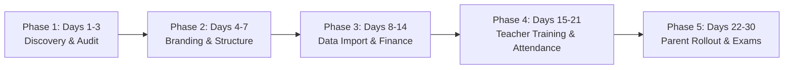

# EDUCATIONOS — INSTITUTIONAL ONBOARDING PLAYBOOK
## 30-Day Phased Adoption Framework, Change Management & Operational Readiness

**Document Version:** 2026.1-ONBOARD  
**Classification:** Institutional Deployment & Customer Success Playbook  
**Target Audience:** School Principals, Academic Coordinators, IT Leads, and Implementation Champions  

---

## 1. Executive Implementation Strategy

Adopting a new institutional operating system is rarely a purely technical challenge; it is fundamentally a **change management and human adoption process**.

If teachers feel overwhelmed by complex data-entry burdens or parents find a mobile portal unintuitive, software investments fail regardless of their underlying code quality.

**EducationOS guarantees successful adoption through four pillars:**
1. **Zero High-Stress "Big Bang" Cutover:** We deploy gradually in five structured, low-risk phases.
2. **Parallel Run Assurance:** Schools maintain paper registers alongside the digital system during Week 3 to eliminate operational risk.
3. **Frictionless Mobile-First Experience:** Teachers take attendance via 1-tap mobile PWA with full offline sync. No bulky hardware or desktop reliance.
4. **Dedicated Institutional Champion:** A designated school staff member is empowered as the internal systems expert with priority support access.

---

## 2. The 30-Day Institutional Roadmap

---

### Phase 1: Discovery, Stakeholder Alignment & Audit (Days 1 to 3)

**Objective:** Understand the school's unique academic structure and establish project leadership.

- **Milestone 1.1 — Form the Steering Committee:**
  - Executive Sponsor: School Principal or Chairman.
  - Project Lead: Head of Administration or Senior IT Coordinator.
  - Educator Champion: A respected senior teacher to represent faculty needs.
- **Milestone 1.2 — Baseline Data Audit:**
  - Collect current student registers (paper ledgers or Excel sheets).
  - Collect standard fee structures, payment due dates, and existing concession/scholarship lists.
  - Document academic grading rules (NCTB GPA or custom institutional grading).
- **Deliverable:** Signed Implementation Scope & Data Ingest Checklist.

---

### Phase 2: Tenant Provisioning, Branding & Structure (Days 4 to 7)

**Objective:** Configure the school’s digital campus and secure administrative access.

- **Milestone 2.1 — Digital Workspace Creation:**
  - Provision tenant workspace with custom subdomain (e.g., `ksis.schoolos.org` or `portal.schoolname.edu.bd`).
  - Configure institutional branding: high-resolution logo, official address, contact phones, and motto.
- **Milestone 2.2 — Academic Architecture Definition:**
  - Define operating shifts: Morning Shift, Day Shift.
  - Setup Classes and Sections (e.g., Class 1 Section A, Class 1 Section B).
  - Setup Subject Catalog and map them to respective classes (Bangla, English, Mathematics, Science).
- **Milestone 2.3 — Role-Based Access Control (RBAC) Setup:**
  - Provision administrative accounts: Principal, Vice-Principal, Head Accountant.
  - Enforce initial password updates and configure TOTP MFA for finance and administrative roles.
- **Deliverable:** Live, branded administrative dashboard ready for data ingestion.

---

### Phase 3: Data Ingestion, Verification & Financial Baseline (Days 8 to 14)

**Objective:** Clean, import, and cryptographically verify all student and guardian records.

- **Milestone 3.1 — CSV Bulk Data Import:**
  - Format existing student records into the standard EducationOS CSV template (Roll, Name, Class, Section, Guardian Name, Mobile Number, Blood Group, Date of Birth).
  - Execute automated data validation: system flags duplicate roll numbers, malformed 11-digit Bangladesh phone numbers, or missing required fields.
- **Milestone 3.2 — Guardian & Student Digital Twin Verification:**
  - System automatically associates siblings with shared guardian phone numbers, creating unified multi-child parent accounts.
- **Milestone 3.3 — Fee Structure & Ledger Configuration:**
  - Configure monthly tuition fees, admission fees, session fees, and examination charges.
  - Verify that dual-copy receipts print accurately on standard school A4 printers with institutional letterhead.
- **Deliverable:** 100% verified student directory with active guardian linkages and accurate financial ledger.

---

### Phase 4: Educator Enablement & Smart Attendance Pilot (Days 15 to 21)

**Objective:** Train teachers and achieve 100% daily digital attendance compliance.

- **Milestone 4.1 — 45-Minute Hands-On Educator Workshop:**
  - Teachers install the EducationOS PWA on their smartphones via Chrome/Safari ("Add to Home Screen").
  - Practice taking attendance in offline airplane mode to experience automatic synchronization.
  - Introduction to the AI Academic Copilot: generating a 10-question sample quiz from a textbook chapter.
- **Milestone 4.2 — Parallel Attendance Drill:**
  - For five consecutive school days, teachers take morning roll call using both the paper register and the 1-tap mobile app.
  - Daily audit compares physical registers with digital attendance to build educator trust and eliminate discrepancies.
- **Milestone 4.3 — Daily Lesson Diary Adoption:**
  - Teachers begin logging brief classroom topics and homework assignments via their mobile dashboard.
- **Deliverable:** 100% faculty comfort with mobile attendance and lesson logging. Paper registers retired at the end of Week 3.

---

### Phase 5: Parent Mobile Rollout, Examination Drill & Handover (Days 22 to 30)

**Objective:** Delight parents with real-time transparency and conduct the first digital examination workflow.

- **Milestone 5.1 — Parent Onboarding Circular & SMS Push:**
  - Issue official school notice with step-by-step instructions for logging into the Parent Portal.
  - Send SMS broadcast with one-click access links.
- **Milestone 5.2 — Live Fee Collection & Counter Receipts:**
  - School cashier issues first live digital fee receipts via the Finance Desk.
  - Parents receive immediate SMS and mobile receipt confirmations.
- **Milestone 5.3 — Examination Mock Run:**
  - Enter marks for a recent class assessment.
  - Generate digital report cards with NCTB GPA calculation and verify print formatting.
- **Milestone 5.4 — Formal Implementation Sign-Off:**
  - Final review with School Principal and Board.
  - Transition from Implementation Support to 24/7 Ongoing Institutional Customer Success.
- **Deliverable:** Fully autonomous, paper-free institutional operation.

---

## 3. Change Management: Overcoming Institutional Resistance

| Common Friction Point | Root Cause | EducationOS Solution & Best Practice |
| :--- | :--- | :--- |
| **"Senior teachers are uncomfortable with smartphones."** | Fear of making mistakes or being embarrassed in front of students. | The 1-tap attendance interface uses high-contrast Bengali text, giant touch targets, and default "All Present" with quick absent toggles. We conduct gentle 1-on-1 walkthroughs. |
| **"Our classrooms have weak WiFi or mobile data."** | Infrastructure gaps in traditional school buildings. | Our PWA utilizes native IndexedDB caching. Teachers can take roll call without any internet; the app automatically syncs whenever they step into the staff room or courtyard. |
| **"Parents will flood the office with login questions."** | Forgotten passwords and complicated registration steps. | Parents log in simply using their registered mobile phone number. No confusing passwords to memorize; secure session persistence keeps them logged in. |
| **"What if the power goes out during fee collection?"** | Power grid instability during peak morning fee collection hours. | Cashiers can operate from laptops or mobile tablets on battery power; pending transactions queue safely and print or sync immediately upon reconnection. |

---

## 4. Key Success Metrics (Day 30 Review)

A successful onboarding achieves the following verifiable metrics:
- **100% of classes** completing digital roll call by 09:30 AM daily.
- **> 85% of parents** active on the mobile portal or receiving daily automated alerts.
- **Zero data discrepancies** between fee collections and bank deposit slips.
- **At least 3 lesson plans or exam drafts** composed by faculty using the AI Academic Copilot.

