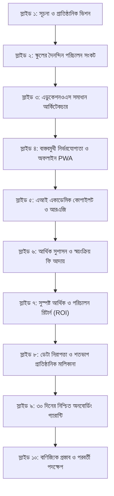

# এডুকেশনওএস — প্রাতিষ্ঠানিক সেলস প্রপোজাল ও পিচ ডেক
## প্রেজেন্টেশন গাইডলাইন, ভ্যালু প্রপোজিশন ও পরিচালনা পর্ষদের জন্য আলোচনা রূপরেখা

**ডকুমেন্ট সংস্করণ:** 2026.1-PITCH  
**শ্রেণিবিভাগ:** প্রাতিষ্ঠানিক সেলস প্রেজেন্টেশন ও বোর্ডরুম পিচ  
**উদ্দিষ্ট দর্শক:** স্কুলের প্রতিষ্ঠাতা, পরিচালনা পর্ষদের সভাপতি ও সদস্যবৃন্দ, অধ্যক্ষ এবং একাডেমি পরিচালক  

---

## ১. নির্বাহী সারসংক্ষেপ ও পিচ প্রেক্ষিত (Executive Narrative)

বর্তমান যুগে শিক্ষা প্রতিষ্ঠানগুলোর প্রশাসনিক কার্যক্রমে নানা অদৃশ্য অপচয় ও সংকট বিদ্যমান:
- **প্রশাসনিক ক্লান্তি:** অধ্যক্ষ ও উপাধ্যক্ষদের কর্মদিবসের ৭০% সময় নষ্ট হয় ফাইলিং, রেজিস্টার খোঁজাখুঁজি এবং করণিক জটিলতা মেটাতে—যা মানসম্মত শিক্ষার পরিবেশ তৈরিতে বাধা সৃষ্টি করে।
- **বকেয়া বেতন ও আর্থিক অনিয়ম:** ম্যানুয়াল রসিদ বই, নগদ টাকা আদায়ের ভুলভ্রান্তি এবং অস্বস্তিকর তাগাদার কারণে প্রতি মাসে ১৫% থেকে ২৫% শিক্ষার্থীর বেতন সময়মতো আদায় হয় না।
- **শিক্ষকদের মানসিক চাপ:** শিক্ষকদের রাতের পর রাত পরীক্ষার প্রশ্ন টাইপ করা, নম্বর যোগ করা এবং হাতে প্রগ্রেস রিপোর্ট কার্ড লিখতে অতিরিক্ত সময় ব্যয় করতে হয়।
- **অভিভাবকদের সাথে দূরত্বের সংকট:** সন্তান নিয়মিত ক্লাসে উপস্থিত হচ্ছে কি না তা অভিভাবকরা জানতে পারেন অনেক দেরিতে।

**এডুকেশনওএস কেবল একটি ডেটা এন্ট্রি সফটওয়্যার নয়।**  
এটি একটি **কৃত্রিম বুদ্ধিমত্তা চালিত বুদ্ধিবৃত্তিক শিক্ষা ইকোসিস্টেম (AI-Powered Intelligent Education Ecosystem)**, যা প্রশাসন, শিক্ষা পরিকল্পনা, আর্থিক সুশাসন এবং অভিভাবক সংযোগকে একটি শক্তিশালী ও নির্ভরযোগ্য প্ল্যাটফর্মে একত্রিত করে।

---

## ২. স্লাইড-বাই-স্লাইড বোর্ডরুম প্রেজেন্টেশন ডেক

---

### স্লাইড ১: সূচনা — আধুনিক বুদ্ধিদীপ্ত শিক্ষা ব্যবস্থাপনার সূচনা

- **শিরোনাম:** আপনার প্রতিষ্ঠানকে রূপান্তর করুন একটি স্মার্ট ও স্বয়ংসম্পূর্ণ শিক্ষা ইকোসিস্টেমে
- **ভিজ্যুয়াল:** ল্যাপটপ, ট্যাবলেট এবং মোবাইলে স্কুলের নিজস্ব লোগো সম্বলিত এডুকেশনওএস ড্যাশবোর্ডের আধুনিক প্রিভিউ।
- **উপস্থাপকের বক্তব্য:**
  > "শ্রদ্ধেয় পরিচালনা পর্ষদের সভাপতি, সম্মানিত অধ্যক্ষ মহোদয় এবং উপস্থিত সদস্যবৃন্দ: আপনাদের আন্তরিক শুভেচ্ছা। আজ আমরা আপনাদের সামনে এমন একটি আধুনিক প্রযুক্তি তুলে ধরতে এসেছি, যেখানে কাগুজে রেজিস্টারের দিন শেষ হবে, কৃত্রিম বুদ্ধিমত্তার ছোঁয়ায় শিক্ষকরা ফিরে পাবেন গবেষণার সময়, এবং প্রতিটি অভিভাবক অনুভব করবেন প্রতিষ্ঠানের সাথে এক নিবিড় আস্থা। এডুকেশনওএস-এ আপনাদের স্বাগত।"

---

### স্লাইড ২: স্কুলের দৈনন্দিন পরিচালন সংকট ও অদৃশ্য অপচয়

- **শিরোনাম:** সনাতন ব্যবস্থার অদৃশ্য পরিচালন সংকট
- **তিনটি প্রধান সংকট:**
  1. *হাজিরা খাতার সংকট:* প্রতিদিন সকালে ক্লাসের প্রথম ১৫ মিনিট সময় নষ্ট হয় খাতা দেখে রোল ডাকতে; অনুপস্থিত শিক্ষার্থীর অভিভাবক কিছুই জানতে পারেন না।
  2. *আর্থিক ধোঁয়াশা:* কাগুজে রসিদ বইয়ের ভুল, বকেয়া জমতে থাকা এবং মাস শেষে হিসাব মিলাতে ক্লান্তিকর জটিলতা।
  3. *পরীক্ষা ও প্রশ্ন তৈরির চাপ:* পাঠ্যবই খুঁজে প্রশ্ন টাইপ করা এবং শত শত শিক্ষার্থীর গ্রেড হাতে হিসাব করে রিপোর্ট কার্ড বানাতে শিক্ষকদের নির্ঘুম রাত।
- **উপস্থাপকের বক্তব্য:**
  > "আমাদের শিক্ষা প্রতিষ্ঠানগুলোর মূল লক্ষ্য হওয়া উচিত মানসম্মত শিক্ষাদান। কিন্তু শিক্ষক ও কর্মকর্তারা যদি দিনের বড় অংশ ব্যয় করেন হিসাবের গরমিল মেটাতে কিংবা রিপোর্ট কার্ড লিখতে, তবে শিক্ষার গুণগত মান নিশ্চিত হবে কীভাবে? এডুকেশনওএস প্রথম দিন থেকেই এই প্রশাসনিক বোঝাগুলো সম্পূর্ণরূপে দূর করে।"

---

### স্লাইড ৩: সমাধান — সমন্বিত এডুকেশনওএস ইকোসিস্টেম

- **শিরোনাম:** শুধু শিক্ষা ব্যবস্থাপনা নয়, শিক্ষাকে বুদ্ধিবৃত্তিক রূপান্তর
- **চারটি সমন্বিত স্তর:**
  - **প্রশাসন ও আরবেসি:** প্রতিষ্ঠানের নিজস্ব লোগো ও শতভাগ নিরাপত্তা নিয়ন্ত্রণ।
  - **মোবাইল পিডব্লিউএ ও হাজিরা:** ১-ট্যাপে ৩০ সেকেন্ডে হাজিরা ও অফলাইন সিঙ্ক।
  - **আর্থিক সুশাসন:** স্কুল ও শিক্ষার্থীর জন্য ডিজিটাল রসিদ ও স্বয়ংক্রিয় বকেয়া ট্র্যাকিং।
  - **এআই একাডেমিক কোপাইলট:** এনসিটিবি পাঠ্যবইভিত্তিক বাংলা ও ইংরেজি প্রশ্নপত্র তৈরিকারক।
- **উপস্থাপকের বক্তব্য:**
  > "এডুকেশনওএস তৈরি করা হয়েছে আমাদের দেশের বাস্তব পরিবেশকে মাথায় রেখে। এটি ব্যবহারের জন্য দামি কম্পিউটার বা সার্বক্ষণিক হাই-স্পিড ব্রডব্যান্ড ইন্টারনেটের প্রয়োজন নেই। সাধারণ স্মার্টফোনে অফলাইনেও এটি বিদ্যুৎগতিতে কাজ করে।"

---

### স্লাইড ৪: বাস্তবমুখী নির্ভরযোগ্যতা — অফলাইন পিডব্লিউএ প্রযুক্তি

- **শিরোনাম:** ক্লাসরুমের বাস্তবতায় পরীক্ষিত: চলবে যেকোনো সময়, যেকোনো স্থানে
- **প্রধান সুবিধাসমূহ:**
  - **১-ট্যাপ রোল কল:** প্রতি ক্লাসে মাত্র ৩০ সেকেন্ডে সকালের হাজিরা সম্পন্ন।
  - **ইন্টারনেটবিহীন কর্মক্ষমতা (Offline PWA):** ক্লাসরুমে ওয়াইফাই বা মোবাইল ডেটা না থাকলেও শিক্ষকের ফোনে কোনো বাধার সৃষ্টি হয় না।
  - **স্বয়ংক্রিয় ব্যাকআপ:** শিক্ষক বারান্দা বা স্টাফরুমে পৌঁছামাত্রই ইন্টারনেট সংযোগে ডেটা স্বয়ংক্রিয়ভাবে ক্লাউডে সেভ হয়ে যায়।
  - **মেমোরি বাঁচানো প্রযুক্তি:** প্লে স্টোর থেকে ১০০ এমবি অ্যাপ ডাউনলোডের ঝামেলা নেই; ব্রাউজার থেকে সরাসরি মোবাইলের হোমস্ক্রিনে ইনস্টল হয়।

---

### স্লাইড ৫: এআই একাডেমিক কোপাইলট ও কারিকুলাম আরএজি (RAG)

- **শিরোনাম:** শিক্ষকদের হাতে কৃত্রিম বুদ্ধিমত্তার আধুনিক সহায়ক
- **প্রধান সুবিধাসমূহ:**
  - **মুহূর্তে দ্বিভাষিক প্রশ্নপত্র প্রস্তুত:** নির্দিষ্ট শ্রেণির যেকোনো অধ্যায় নির্বাচন করে এক ক্লিকে সৃজনশীল প্রশ্ন, বহুনির্বাচনী ও সংক্ষিপ্ত প্রশ্ন তৈরি।
  - **সিলেবাসের বাইরে যাওয়ার সুযোগ নেই (Strict RAG):** আমাদের এআই সিস্টেম শুধুমাত্র অনুমোদিত এনসিটিবি পাঠ্যবই ও সিলেবাসের তথ্য বিশ্লেষণ করে প্রশ্ন তৈরি করে।
  - **শিক্ষকের চূড়ান্ত কর্তৃত্ব (Human Invariant):** এআই কখনো সরাসরি প্রশ্ন চূড়ান্ত করে না; খসড়া (Draft) তৈরি করে দেয়। শিক্ষক পর্যালোচনা ও পরিমার্জন করে তবেই তা প্রিন্ট করেন।

---

### স্লাইড ৬: আর্থিক সুশাসন ও শতভাগ স্বচ্ছ হিসাবরক্ষণ

- **শিরোনাম:** পেশাদার ফি আদায় ব্যবস্থা, হিসাবের কোনো অমিল নয়
- **প্রধান সুবিধাসমূহ:**
  - **দ্বি-কপি বিশিষ্ট প্রফেশনাল রসিদ:** স্কুলের অফিসিয়াল সিল ও কিউআর কোডসহ শিক্ষার্থী ও অফিসের জন্য তাত্ক্ষণিক প্রিন্টযোগ্য রসিদ।
  - **ক্যাশ, বিকাশ ও ব্যাংক রিকনসিলিয়েশন:** কোন খাতে কত নগদ এলো বা কত বিকাশে জমা হলো—সবকিছু এক লেজারে সমন্বিত।
  - **স্বয়ংক্রিয় শিষ্টাচারপূর্ণ এসএমএস রিমাইন্ডার:** কাউকে ফোনে ডেকে অস্বস্তিকর তাগাদা দিতে হবে না; নির্ধারিত তারিখের পূর্বে অভিভাবকের মোবাইলে স্বয়ংক্রিয় মেসেজ পৌঁছে যায়।
  - **অডিট প্রমাণযোগ্য হিসাব:** যেকোনো ব্যাকডেটেড পরিবর্তন বা বেআইনি ছাড় প্রতিরোধ করে অপরিবর্তনীয় অডিট লগ।

---

### স্লাইড ৭: বিনিয়োগের সুস্পষ্ট প্রাতিষ্ঠানিক সুফল (Quantifiable ROI)

| প্রাতিষ্ঠানিক খাত | সনাতন কাগুজে ব্যবস্থা | এডুকেশনওএস ইকোসিস্টেম | প্রতিষ্ঠানের নিট লাভ |
| :--- | :--- | :--- | :--- |
| **সকালের হাজিরা** | ক্লাসপ্রতি ১৫ মিনিট প্রতিদিন | ক্লাসপ্রতি মাত্র ৩০ সেকেন্ড | **প্রতি মাসে ৪৫+ ঘণ্টা** শিক্ষকের কর্মঘণ্টা সাশ্রয় |
| **প্রশ্নপত্র প্রণয়ন** | প্রতিটি বিষয়ে ৩ থেকে ৫ ঘণ্টা | মাত্র ১৫ মিনিটে পূর্ণাঙ্গ প্রশ্ন | শিক্ষকদের প্রস্তুতিজনিত ক্লান্তি **৮৫% হ্রাস** |
| **সময়মতো ফি আদায়** | ৬৫% থেকে ৭৫% সময়ে আদায় | ৮৮% থেকে ৯৪% সময়ে আদায় | **+১৮% থেকে ২৫%** দ্রুত নগদ প্রবাহ বৃদ্ধি |
| **টার্মিনাল রেজাল্ট প্রস্তুত** | শিক্ষকদের ২ সপ্তাহ ধরে নম্বর যোগ | ১-ক্লিকে তাৎক্ষণিক জিপিএ হিসাব | **১০০% নির্ভুল ফলাফল**, যথাসময়ে রেজাল্ট প্রদান |

---

### স্লাইড ৮: ডেটা নিরাপত্তা ও শতভাগ প্রাতিষ্ঠানিক মালিকানা

- **শিরোনাম:** ব্যাংক-মানের ডেটা আইসোলেশন ও আপনার তথ্যের পূর্ণ সুরক্ষা
- **নিরাপত্তা নিশ্চয়তা:**
  - **PostgreSQL Native RLS:** ডেটাবেজের কার্নেল স্তরে ডেটা আলাদা থাকে; এক স্কুলের তথ্যের সাথে অন্য স্কুলের কোনো মিশ্রণ ঘটার সুযোগ নেই।
  - **বিজ্ঞাপন বা ডেটা বিক্রি সম্পূর্ণ নিষিদ্ধ:** আমরা কখনোই কোনো বাণিজ্যিক সংস্থাকে শিক্ষার্থী বা অভিভাবকদের তথ্য দেখতে দিই না।
  - **পূর্ণ ডেটা পোর্টেবিলিটি:** যেকোনো সময় এক ক্লিকে সম্পূর্ণ শিক্ষার্থী তথ্য ও আর্থিক হিসাব এক্সেল/সিএসভিতে ডাউনলোড করার স্বাধীনতা।
  - **টু-ফ্যাক্টর অথেনটিকেশন (TOTP MFA):** স্কুলের অধ্যক্ষ ও প্রধান হিসাবরক্ষকের একাউন্টের জন্য ব্যাংক-গ্রেড নিরাপত্তা।

---

### স্লাইড ৯: ৩০ দিনের নিশ্চিত ও ঝুঁকিমুক্ত বাস্তবায়ন গ্যারান্টি

- **শিরোনাম:** কোনো ঝুটঝামেলা ছাড়া সহজ রূপান্তর
- **আমাদের প্রতিশ্রুতি:**
  - *১ম সপ্তাহ:* আপনার স্কুলের বর্তমান এক্সেল বা খাতা থেকে ডেটা ট্রান্সফার ও সেটিংস আমাদের টিম নিজ দায়িত্বে করবে।
  - *২য় সপ্তাহ:* কাগুজে রেজিস্টারের পাশাপাশি মোবাইলে হাজিরা চলবে যাতে কোনো তথ্য মিস না হয়।
  - *৩য় সপ্তাহ:* শিক্ষকদের জন্য মাত্র ৪৫ মিনিটের সহজ প্রশিক্ষণ (যাঁরা স্মার্টফোনে কম দক্ষ, তাঁদের হাতে-কলমে শেখানো হবে)।
  - *৪র্থ সপ্তাহ:* অভিভাবক অ্যাপের উদ্বোধন ও আনুষ্ঠানিক লাইভ রূপান্তর।

---

### স্লাইড ১০: বাণিজ্যিক সিদ্ধান্ত ও পরবর্তী পদক্ষেপ

- **শিরোনাম:** আপনার প্রতিষ্ঠানকে আগামীর নেতৃত্বে নিয়ে আসুন
- **পরবর্তী ৩টি সহজ পদক্ষেপ:**
  1. আমাদের **১৪ দিনের পূর্ণাঙ্গ ফ্রি প্রাতিষ্ঠানিক ট্রায়াল** অনুমোদন করুন।
  2. যেকোনো ১টি বা ২টি ক্লাসের নমুনা শিক্ষার্থী তালিকা আমাদের দিন যাতে আমরা আপনাদের নামে লাইভ প্রটোটাইপ প্রদর্শন করতে পারি।
  3. শিক্ষক ও পরিচালনা পর্ষদের জন্য একটি ২০ মিনিটের লাইভ ডেমো সেশন নির্ধারণ করুন।
- **উপস্থাপকের সমাপ্তি বক্তব্য:**
  > "যেসব প্রতিষ্ঠান সময়ের সাথে সাথে আধুনিক প্রযুক্তিকে আপন করে নেয়, তারাই সমাজে দীর্ঘস্থায়ী আস্থা ও নেতৃত্ব তৈরি করে। আপনাদের প্রতিষ্ঠানকে অনন্য উচ্চতায় নিয়ে যেতে আমরা আপনাদের পাশে থাকতে প্রস্তুত। ধন্যবাদ।"

