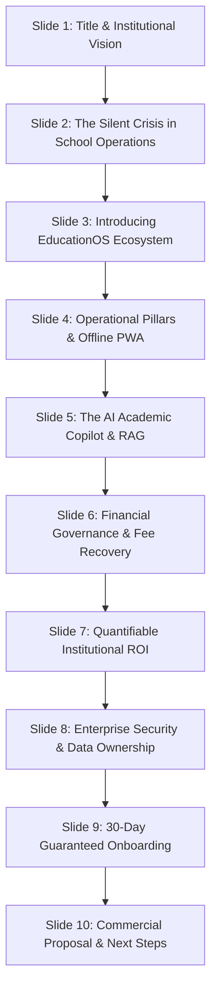

# EDUCATIONOS — INSTITUTIONAL SALES PROPOSAL & PITCH DECK
## Presentation Guide, Value Proposition & Commercial Talking Points

**Document Version:** 2026.1-PITCH  
**Classification:** Institutional Sales Enablement & Boardroom Pitch  
**Target Audience:** School Owners, Board of Trustees, Principals, and Academy Founders  

---

## 1. Executive Summary & Pitch Narrative

Educational leadership faces an escalating crisis of operational friction:
- **Administrative Fatigue:** Principals spend 70% of their day resolving logistical and clerical breakdowns instead of elevating academic standards.
- **Revenue Leakage & Fee Arrears:** Up to 20% of monthly tuition is delayed or lost due to paper-based receipt books, manual reconciliations, and uncomfortable payment reminders.
- **Educator Burnout:** Senior teachers spend evenings typing exam papers, compiling mark sheets, and handwriting report cards.
- **Guardian Anxiety:** Parents feel disconnected from their children's daily attendance and progress until parent-teacher meetings or end-of-term crises.

**EducationOS is not just another school management database.**  
It is an **AI-Powered Intelligent Education Ecosystem** that unifies administration, academic intelligence, financial governance, and parent engagement into a single, high-reliability platform.

---

## 2. Slide-by-Slide Boardroom Presentation Deck

---

### Slide 1: Title & The Intelligent Education Era

- **Slide Headline:** Modernize Your Institution into an Intelligent Education Ecosystem
- **Visual:** Clean institutional mockup showing EducationOS on desktop, tablet, and mobile, co-branded with the prospective school's name and logo.
- **Presenter Script:**
  > "Distinguished members of the board and respected Principal: Thank you for your leadership and dedication to educational excellence. Today, we invite you to imagine an institution where administrative chaos is permanently replaced by automated precision, where teachers are liberated from clerical drudgery by artificial intelligence, and where every parent feels an immediate, transparent bond with your school. Welcome to EducationOS."

---

### Slide 2: The Silent Friction Holding Schools Back

- **Slide Headline:** The Hidden Cost of Fragmented Systems
- **Three Core Pain Points:**
  1. *Paper Register Bottlenecks:* 15 minutes lost per class every morning; absentee parents are not notified until hours later.
  2. *Financial Ambiguity:* Delayed tuition fees, disputed payments, and stressful cash reconciliations at the end of every month.
  3. *Exam Preparation Overload:* Teachers spending dozens of hours formatting question papers and manually calculating GPA rankings.
- **Presenter Script:**
  > "In most institutions, excellence is stifled not by a lack of teaching talent, but by administrative friction. When your senior teachers spend hours tallying marks or typing exam questions, that is time stolen from student mentoring. When parents don't receive instant alerts about absent children, trust is eroded. EducationOS eliminates these bottlenecks from Day One."

---

### Slide 3: The EducationOS Solution Architecture

- **Slide Headline:** Not Just Managing Education. Making Education Intelligent.
- **Visual:** Diagram illustrating the 4 integrated layers:
  - **Administration & RBAC:** Complete control with zero data leakage.
  - **Mobile PWA & Attendance:** Instant 1-tap roll call with offline sync.
  - **Financial Engine:** Automated dual-copy fee receipts and ledger reconciliation.
  - **AI Academic Copilot:** Bengali-aware curriculum RAG question generation.
- **Presenter Script:**
  > "EducationOS is designed specifically for South Asian educational realities. Unlike legacy software that requires high-end servers and constant fast broadband, EducationOS operates as a lightweight Progressive Web App on standard smartphones, even during network blackouts. It brings your school into the modern era without requiring expensive new IT hardware."

---

### Slide 4: Real-World Reliability: The Offline PWA Advantage

- **Slide Headline:** Built for Classroom Realities: Works Anywhere, Anytime
- **Key Talking Points:**
  - **1-Tap Roll Call:** Complete morning attendance in under 30 seconds per classroom.
  - **Offline Resilience:** If the school WiFi drops or cellular data is unavailable, the teacher's phone records attendance locally in IndexedDB without freezing.
  - **Automatic Cloud Sync:** The moment the teacher reaches an area with signal, attendance updates seamlessly in the background.
  - **Zero App Store Clutter:** No 100MB downloads; installs instantly from the browser to the mobile home screen.

---

### Slide 5: The AI Academic Copilot & NCTB Curriculum RAG

- **Slide Headline:** Empower Teachers with an Intelligent Co-Teacher
- **Key Talking Points:**
  - **Bilingual Question Paper Generation:** Generate balanced exam papers (Creative Questions, MCQs, Short Answers) aligned with specific textbook chapters in under 60 seconds.
  - **Strict Curriculum Grounding:** Our Retrieval-Augmented Generation (RAG) grounds questions strictly in your uploaded NCTB syllabus and approved textbooks. Zero hallucinated topics.
  - **Educator Authority (Human Invariant):** AI always saves outputs as a `Draft`. Teachers review, modify, adjust marks, and approve before printing.
- **Presenter Script:**
  > "Imagine giving every teacher in your faculty an intelligent teaching assistant that reads the entire NCTB curriculum, helps format bilingual question papers in seconds, and provides step-by-step lesson outlines. Teachers don't burn out; they become master educators."

---

### Slide 6: Financial Governance & Automated Fee Recovery

- **Slide Headline:** Professional Fee Collection, Zero Disputed Payments
- **Key Talking Points:**
  - **Dual-Copy Thermal & A4 Receipts:** Instant print receipts with official school seal, one copy for the parent and one for the cashier counter.
  - **Multi-Channel Reconciliation:** Track Cash, bKash, Nagad, and Bank wire deposits in a single unified ledger.
  - **Automated Friendly SMS/WhatsApp Reminders:** Eliminate uncomfortable phone calls; parents receive polite automated reminders 3 days before due dates.
  - **Audit Proof:** Immutable ledger logs prevent unauthorized fee alterations or unrecorded discounts.

---

### Slide 7: Quantifiable Institutional Return on Investment (ROI)

| Institutional Area | Traditional Paper / Legacy System | With EducationOS Ecosystem | Net Institutional Gain |
| :--- | :--- | :--- | :--- |
| **Morning Attendance** | 15 mins/class/day (Paper Register) | 30 seconds/class/day (1-Tap PWA) | **45+ hours saved** across faculty monthly |
| **Question Paper Creation** | 3 to 5 hours per subject test | Under 15 minutes (AI Copilot) | **85% reduction** in teacher prep fatigue |
| **Fee Collection On-Time Rate** | 65% to 75% on-time recovery | 88% to 94% on-time recovery | **+18% to 25%** immediate cash flow acceleration |
| **Term Report Card Compilation** | 2 weeks of manual mark tallying | Instant 1-click automated calculation | **Zero calculation errors**, zero delayed report cards |

---

### Slide 8: Enterprise Security & Data Sovereignty

- **Slide Headline:** Bank-Grade Isolation & 100% Institutional Ownership
- **Key Talking Points:**
  - **PostgreSQL Native RLS:** Your school's records are physically isolated at the database kernel level. Zero risk of data leakage to other schools.
  - **Zero Data Commercialization:** We never sell, analyze, or advertise against student or parent data.
  - **Full Data Portability:** Download your complete student directory and financial ledgers at any time in Excel or CSV format.
  - **Two-Factor Authentication (MFA):** Bank-grade security for the Principal and Chief Accountant.

---

### Slide 9: Guaranteed 30-Day Guided Onboarding

- **Slide Headline:** A Proven, Stress-Free Transition
- **The 5-Stage Commitment:**
  - *Week 1:* Academic structure setup and student data migration handled by our specialist team.
  - *Week 2:* Parallel attendance run alongside paper registers to eliminate operational risk.
  - *Week 3:* 45-minute teacher workshop (even teachers with zero tech experience succeed).
  - *Week 4:* Parent portal launch and official school communication.
- **Presenter Script:**
  > "We understand that switching systems feels daunting. That is why we do not leave you with a manual. Our team handles data formatting, conducts teacher training in Bengali, and stands beside your administration until the entire school operates with effortless confidence."

---

### Slide 10: Next Steps & The 14-Day Zero-Risk Trial

- **Slide Headline:** Lead Your Institution into the Future
- **Call to Action:**
  1. Approve the 14-Day Complimentary Institutional Sandbox.
  2. Provide a sample student roster (Class 1 & 2) for immediate prototype demo.
  3. Schedule a 30-minute faculty showcase.
- **Presenter Closing:**
  > "Educational institutions that embrace intelligent systems today will set the standard for learning tomorrow. Let us partner with you to make your school the premier institution in your community. Thank you."

