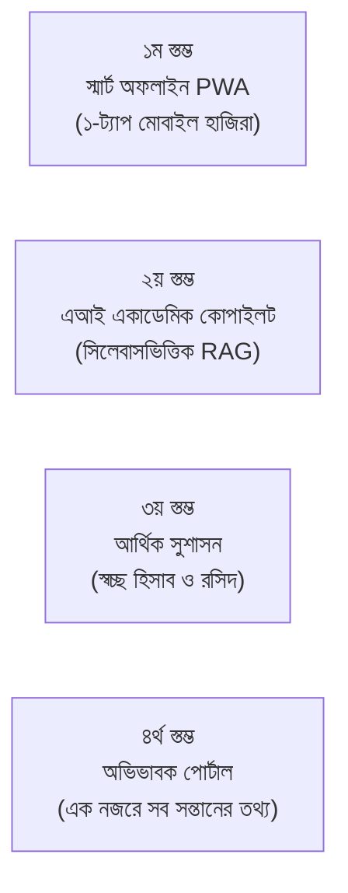

# এডুকেশনওএস — প্রাতিষ্ঠানিক ওয়েবসাইট কনটেন্ট ও কনভার্সন কপি
## প্রাতিষ্ঠানিক পজিশনিং, প্রোডাকশন-রেডি মাইক্রোকপি ও গ্রাহক রূপান্তর রূপরেখা

**ডকুমেন্ট সংস্করণ:** 2026.1-WEB  
**শ্রেণিবিভাগ:** ডিজিটাল অভিজ্ঞতা, প্রাতিষ্ঠানিক ওয়েব কনটেন্ট ও কনভার্সন কপি  
**উদ্দিষ্ট পাঠক:** শিক্ষা প্রতিষ্ঠানের প্রতিষ্ঠাতা, সভাপতি, অধ্যক্ষ, প্রধান শিক্ষক এবং একাডেমি পরিচালক  

---

## ১. ব্র্যান্ডের ভাষা, পজিশনিং ও মূলনীতি (Brand Voice & Tone)

- **ক্যাটেগরি সংজ্ঞা:** "কৃত্রিম বুদ্ধিমত্তা চালিত বুদ্ধিবৃত্তিক শিক্ষা ইকোসিস্টেম"
- **প্রধান প্রাতিষ্ঠানিক স্লোগান:** "শুধু শিক্ষা ব্যবস্থাপনা নয়, শিক্ষাকে বুদ্ধিবৃত্তিক ও আধুনিক রূপান্তর।"
- **কপিরাইটিংয়ের ৩টি মূলনীতি:**
  ১. *ফাঁকা কথার বদলে সুনির্দিষ্ট কার্যকারিতা:* কোনো ভিত্তিহীন চটকদার শব্দ নয়; প্রতিটি সুবিধার পেছনে কোডবেসের বাস্তব প্রযুক্তি তুলে ধরতে হবে (যেমন: "অফলাইন পিডব্লিউএ প্রযুক্তি", "পোস্টগ্রেএসকিউএল কার্নেল-স্তরের রো-লেভেল সিকিউরিটি")।  
  ২. *শিক্ষকের বিকল্প নয়, শিক্ষকের সহায়ক:* কৃত্রিম বুদ্ধিমত্তাকে কখনোই শিক্ষকের বিকল্প হিসেবে তুলে ধরা হবে না; এটি শিক্ষকের কাজের বোঝা লাঘবকারী এক অনন্য ডিজিটাল সহকারী (`Pedagogical Human Invariant`)।  
  ৩. *শতভাগ সত্যনিষ্ঠতা:* কোনো মিথ্যা পার্টনারশিপ বা অতিরঞ্জিত দাবি করা যাবে না। প্রতিটি বাক্য সিস্টেমের বাস্তব সক্ষমতার সাথে সংগতিপূর্ণ হতে হবে।

---

## ২. হোমপেজ কনটেন্ট কাঠামো (Homepage Architecture)

### ২.১ হিরো সেকশন (Hero Section)

- **টপ আইব্রো ব্যাজ:**
  `[ ⚡ আধুনিক শিক্ষা প্রতিষ্ঠানের স্বয়ংসম্পূর্ণ অপারেটিং ইকোসিস্টেম · সংস্করণ ২০২৬.১ ]`
- **প্রধান শিরোনাম (H1):**
  # শুধু শিক্ষা ব্যবস্থাপনা নয়, শিক্ষাকে বুদ্ধিবৃত্তিক ও আধুনিক রূপান্তর।
- **উপ-শিরোনাম (Sub-headline):**
  স্কুল, কলেজ ও কোচিং একাডেমির সার্বিক কার্যক্রম পরিচালনার এক অনন্য আধুনিক ইকোসিস্টেম। দৈনন্দিন ডিজিটাল হাজিরা, এনসিটিবি গ্রেডিং ও প্রগ্রেস রিপোর্ট, বকেয়া ফি আদায় এবং কৃত্রিম বুদ্ধিমত্তাভিত্তিক প্রশ্নপত্র প্রণয়ন—সবকিছুই এখন এক ক্লিকে, অফলাইনেও সমান কার্যকরী।
- **প্রধান অ্যাকশন বাটন (Primary CTA):**
  `[ ২০ মিনিটের একটি লাইভ ডেমো সেশন বুক করুন → ]`
- **দ্বিতীয় বাটন (Secondary CTA):**
  `[ ইন্টারঅ্যাক্টিভ প্রাইসিং ক্যালকুলেটর দেখুন ]`
- **বিশ্বস্ততার চার প্রতীক (Trust Badges):**
  - `🛡️ PostgreSQL কার্নেল-স্তরের সম্পূর্ণ আইসোলেটেড ডেটাবেজ`
  - `📶 মোবাইল পিডব্লিউএ প্রযুক্তির মাধ্যমে শতভাগ অফলাইনেও সচল`
  - `🇧🇩 জাতীয় শিক্ষাক্রম (NCTB) ও ইংলিশ মিডিয়াম কারিকুলাম উপযোগী`
  - `🔒 প্রতিষ্ঠানের শতভাগ ডেটা মালিকানা ও শতভাগ বিজ্ঞাপনমুক্ত`

---

### ২.২ সনাতন ব্যবস্থার সংকট সেকশন ("The Silent Costs of Legacy Software")

- **বিভাগীয় শিরোনাম:**
  ## মান্ধাতার আমলের সফটওয়্যার কেন আধুনিক শিক্ষা প্রতিষ্ঠানের জন্য যথেষ্ট নয়?
- **ভূমিকা:**
  অধিকাংশ স্কুল আজও চলছে কাগুজে খাতা, জটিল এক্সেল শিট আর পনেরো বছর আগের তৈরি ধীরগতির সফটওয়্যারে। সফটওয়্যার যদি কঠিন হয় তবে শিক্ষকরা তা ব্যবহার করতে চান না, আড়ালে ফি-এর হিসাবে গরমিল তৈরি হয় এবং প্রতিষ্ঠান প্রধান সঠিক তথ্য পান না।
- **তিনটি বাস্তব সংকট ও সমাধান:**
  1. **হাজিরা খাতার সময় অপচয়:**  
     *সমস্যা:* ক্লাসের প্রথম ১৫ মিনিট খাতা দেখে নাম ডাকতেই চলে যায়। ছাত্র ক্লাসে না এলে অভিভাবক তা জানতে পারেন অনেক বিকেলে।  
     *এডুকেশনওএস সমাধান:* ১-ট্যাপে স্মার্টফোনে মাত্র ৩০ সেকেন্ডে গোটা ক্লাসের রোল কল। স্কুলের মোটা দেয়ালের ভেতর নেটওয়ার্ক না থাকলেও অফলাইনে হাজিরা সম্পন্ন হয় এবং সাথে সাথেই স্বয়ংক্রিয় সিঙ্ক হয়।
  2. **বকেয়া বেতন ও রসিদের ঝামেলা:**  
     *সমস্যা:* কাগুজে রসিদ বইয়ের পাতার গরমিল, অযাচিত ছাড় এবং মাস শেষে ক্যাশের হিসাব মিলাতে প্রধান শিক্ষক ও হিসাবরক্ষকের চরম ভোগান্তি।  
     *এডুকেশনওএস সমাধান:* স্কুল ও অভিভাবকের জন্য সিলমোহরযুক্ত দ্বি-কপি বিশিষ্ট স্বয়ংক্রিয় প্রিন্ট রসিদ, ক্যাশ ও বিকাশের সমন্বিত লেজার এবং নির্ধারিত তারিখের আগেই স্বয়ংক্রিয় ভদ্র এসএমএস রিমাইন্ডার।
  3. **প্রশ্নপত্র তৈরি ও ফলাফল প্রস্তুতের ক্লান্তি:**  
     *সমস্যা:* শিক্ষকদের পরীক্ষার আগে নির্ঘুম রাত কাটাতে হয় প্রশ্নপত্র হাত দিয়ে লিখে বা টাইপ করে এবং টার্মিনাল রেজাল্ট বানাতে সপ্তাহের পর সপ্তাহ ক্যালকুলেটরে নম্বর যোগ করতে হয়।  
     *এডুকেশনওএস সমাধান:* এআই কোপাইলট মাত্র ৬০ সেকেন্ডে পাঠ্যবইয়ের নির্দিষ্ট অধ্যায় থেকে সৃজনশীল ও বহুনির্বাচনী প্রশ্ন তৈরি করে দেয়। পরীক্ষা শেষে ১-ক্লিকেই তৈরি হয় এনসিটিবি গ্রেড সম্বলিত আকর্ষণীয় রিপোর্ট কার্ড।

---

### ২.৩ প্ল্যাটফর্মের ৪টি শক্তিশালী স্তম্ভ (The Four Pillars)

#### ১ম স্তম্ভ: অফলাইন স্মার্ট পিডব্লিউএ প্রযুক্তি (ইন্টারনেট ছাড়াও কার্যকর)
- **শিরোনাম:** ক্লাসরুমের বাস্তবতায় পরীক্ষিত: ওয়াইফাই নেই? কোনো সমস্যা নেই।
- **বিবরণ:**  
  আমাদের দেশে প্রায়ই ক্লাসরুমে মোবাইল নেটওয়ার্ক পাওয়া যায় না বা লোডশেডিং হয়। এডুকেশনওএস সরাসরি যেকোনো স্মার্টফোনে পিডব্লিউএ (PWA) অ্যাপ হিসেবে ইনস্টল হয়। ইন্টারনেট বন্ধ থাকলেও শিক্ষক নির্দ্বিধায় হাজিরা নিতে পারেন; শিক্ষক ক্লাসরুম থেকে বের হলেই ডেটা স্বয়ংক্রিয়ভাবে ক্লাউডে ব্যাকআপ হয়ে যায়।

#### ২য় স্তম্ভ: এআই একাডেমিক কোপাইলট ও কারিকুলাম আরএজি (RAG)
- **শিরোনাম:** পাঠ্যবইয়ের নির্ভরযোগ্য তথ্যের ওপর প্রতিষ্ঠিত শিক্ষকের ডিজিটাল সহকারী।
- **বিবরণ:**  
  সাধারণ এআই-এর মতো মনগড়া তথ্য দেওয়া রোধ করতে আমাদের এআই গেটওয়ে সরাসরি আপনার স্কুলের আপলোড করা এনসিটিবি পাঠ্যবই ও সিলেবাসের তথ্য বিশ্লেষণ করে (RAG)। মুহূর্তেই তৈরি করে নির্ভুল সৃজনশীল ও বহুনির্বাচনী প্রশ্নপত্র এবং পাঠ পরিকল্পনা—যেখানে চূড়ান্ত অনুমোদনের ক্ষমতা সর্বদা শিক্ষকের হাতেই সংরক্ষিত।

#### ৩য় স্তম্ভ: আর্থিক সুশাসন ও পেশাদার রসিদ ব্যবস্থাপনা
- **শিরোনাম:** নির্ভুল ক্যাশিয়ার কাউন্টার, হিসাবের শতভাগ স্বচ্ছতা।
- **বিবরণ:**  
  প্রতিষ্ঠানের নাম ও অফিশিয়াল সিলযুক্ত দ্বি-কপি রসিদ প্রিন্ট করুন চোখের পলকে। কাউন্টারে নগদ টাকার পাশাপাশি বিকাশ, নগদ ও ব্যাংকের মাধ্যমে আসা বেতন একই লেজারে স্বয়ংক্রিয়ভাবে সমন্বয় করুন।

#### ৪র্থ স্তম্ভ: অভিভাবকের জন্য আধুনিক মোবাইল পোর্টাল
- **শিরোনাম:** প্রতি মুহূর্তে সন্তানের শিক্ষাজীবনের সাথে অভিভাবকের নিবিড় সংযোগ।
- **বিবরণ:**  
  কোনো পাসওয়ার্ড মনে রাখার ঝামেলা নেই; রেজিস্টার্ড মোবাইল নম্বর দিয়ে অভিভাবক এক ট্যাপেই প্রবেশ করতে পারেন। একই স্কুলে একাধিক সন্তান থাকলে একক স্ক্রিন থেকেই সবার উপস্থিতি, টার্মিনাল ফলাফল ও বেতনের রসিদ দেখা যায়।

---

### ২.৪ সরাসরি তুলনামূলক পর্যালোচনা (Comparison Matrix)

| প্রাতিষ্ঠানিক সুবিধা | কাগুজে খাতা ও এক্সেল শিট | পুরনো ডেস্কটপ সফটওয়্যার | এডুকেশনওএস ইকোসিস্টেম |
| :--- | :---: | :---: | :---: |
| **সকালের হাজিরার গতি** | ১০–১৫ মিনিট প্রতি ক্লাসে | কম্পিউটারে বসে এন্ট্রি দিতে হয় | **শিক্ষকের মোবাইলে মাত্র ৩০ সেকেন্ড** |
| **অফলাইন কর্মক্ষমতা** | আছে (কাগজে) | নেই (সার্ভার ডাউন হলে বন্ধ) | **আছে (IndexedDB অফলাইন সিঙ্ক)** |
| **পাঠ্যবইভিত্তিক এআই সুবিধা** | নেই | নেই | **বাংলা ও ইংরেজি কারিকুলাম RAG** |
| **ডেটা নিরাপত্তা ও সুরক্ষা** | নেই (খাতা হারানোর ঝুঁকি) | সাধারণ কোড (ডেটা ফাঁসের ঝুঁকি) | **পোস্টগ্রেএসকিউএল কার্নেল RLS** |
| **অভিভাবকদের তাৎক্ষণিক অ্যালার্ট** | নেই | রাতে ম্যানুয়াল এসএমএস | **সকালে রোল কলের সাথেই অ্যালার্ট** |
| **খরচের স্বচ্ছতা** | কর্মচারীদের অতিরিক্ত ওভারটাইম | বিশাল এককালীন লাইসেন্স ফি | **ন্যায্য পে-অ্যাজ-ইউ-গ্রো মাসিক মডেল** |

---

### ২.৫ সচরাচর জিজ্ঞাসিত প্রশ্ন ও উত্তর (FAQ)

- **প্রশ্ন: আমাদের ক্লাসরুমে কি সার্বক্ষণিক দ্রুতগতির ইন্টারনেটের প্রয়োজন হবে?**  
  *উত্তর:* একদমই না। শিক্ষকদের জন্য এডুকেশনওএস সম্পূর্ণ অফলাইন-ফার্স্ট প্রযুক্তিতে কাজ করে। ইন্টারনেট সংযোগ না থাকলেও শিক্ষকরা স্বাভাবিকভাবে হাজিরা নিতে পারেন এবং ক্লাসে পড়ানোর টপিক লিখে রাখতে পারেন; পরবর্তীতে ইন্টারনেট পাওয়া মাত্রই তা ক্লাউডে সেভ হয়ে যায়।
- **প্রশ্ন: স্কুলের সমস্ত ডেটার মালিক কে? কোনো বিজ্ঞাপনদাতা কি আমাদের তথ্য দেখতে পারবে?**  
  *উত্তর:* আপনার শিক্ষা প্রতিষ্ঠান তার আপলোড করা সমস্ত ডেটা ও রেকর্ডের ১০০% আইনি ও কার্যত মালিক। আমরা কোনো তৃতীয় পক্ষের কাছে শিক্ষার্থীদের তথ্য বিক্রি করি না এবং কোনো বিজ্ঞাপন দেখাই না। আপনি যেকোনো সময় এক ক্লিকে সম্পূর্ণ ডেটা এক্সেলে ডাউনলোড করে নিতে পারেন।
- **প্রশ্ন: এআই প্রশ্নপত্র কি শিক্ষকের প্রয়োজনকে শেষ করে দেবে?**  
  *উত্তর:* কখনোই নয়। আমাদের সিস্টেমে এআই শুধুমাত্র একটি প্রাথমিক খসড়া তৈরি করে দেয়। শিক্ষক নিজ চোখে তা যাচাই করবেন, প্রয়োজন অনুযায়ী পরিবর্তন বা নম্বর পুনর্বণ্টন করবেন এবং তবেই তা ফাইনাল প্রিন্টের জন্য অনুমোদন পাবে।
- **প্রশ্ন: আমাদের প্রতিষ্ঠানটি চালু করতে কত দিন সময় লাগবে?**  
  *উত্তর:* আমাদের ৩০ দিনের সুপরিকল্পিত অনবোর্ডিং প্রোগ্রামে আমাদের টেকনিক্যাল টিম আপনার পূর্বের খাতা বা এক্সেল থেকে ডেটা ট্রান্সফার করে দেবে এবং শিক্ষকদের বাংলায় সহজ প্রশিক্ষণ দেবে। ২য় সপ্তাহে খাতার পাশাপাশি সমান্তরাল হাজিরা চালানো হয় যাতে কোনো ঝুঁকি না থাকে।

---

### ২.৬ রূপান্তর ও রেজিস্ট্রেশন সেকশন (Final CTA)

- **হেডলাইন:** আপনার প্রতিষ্ঠানকে আগামীর বুদ্ধিদীপ্ত ইকোসিস্টেমে রূপান্তর করতে প্রস্তুত?
- **সাব-হেডলাইন:** শিক্ষা ব্যবস্থাপনায় আধুনিক বিপ্লবের অংশ হোন। আপনার স্কুলের নিজস্ব পাঠ্যক্রম দিয়ে আজই পরীক্ষা করুন আমাদের ১৪ দিনের ঝুঁকিমুক্ত প্রাতিষ্ঠানিক স্যান্ডবক্স।
- **প্রধান বাটন:** `[ আপনার প্রতিষ্ঠানের জন্য ফ্রি ডেমো বুক করুন → ]`
- **সরাসরি যোগাযোগ:** `+৮৮০ ১৭০০-০০০০০০ · প্রাতিষ্ঠানিক পার্টনারশিপ বিভাগ`

