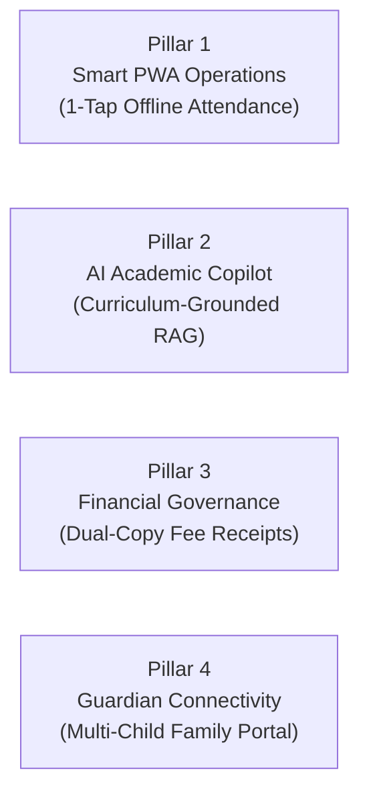

# EDUCATIONOS — WEBSITE COPY & MARKETING MESSAGING SPECIFICATION
## High-Conviction Institutional Positioning, Production-Ready Microcopy & Conversion Funnel

**Document Version:** 2026.1-WEB  
**Classification:** Public Digital Experience & Conversion Copy  
**Audience:** School Owners, Principals, Headmasters, Governing Bodies, and Academy Founders  

---

## 1. Brand Voice, Positioning & Tone Guidelines

- **Category Definition:** "The AI-Powered Intelligent Education Ecosystem"
- **Primary Institutional Tagline:** "Not Just Managing Education. Making Education Intelligent."
- **Tone Profile:** Authoritative, institution-grade, calm, intellectually rigorous, and radically honest.
- **Copywriting Principles:**
  1. *Substance Over Fluff:* Never use empty buzzwords ("revolutionary", "magic", "game-changer") without immediately grounding them in concrete functionality (e.g., "1-tap attendance with IndexedDB offline resilience").
  2. *Empower, Never Replace:* Frame artificial intelligence as an assistant that empowers human educators (`Pedagogical Human Invariant`), never as an autonomous replacement for teachers.
  3. *Radical Truthfulness:* Every feature described must exist in the verified codebase. Never invent nonexistent third-party integrations or partner institutions.

---

## 2. Homepage Copy Architecture

### 2.1 Hero Section

- **Eyebrow Pill:**
  `[⚡ NEXT-GENERATION INSTITUTIONAL OPERATING SYSTEM · VERSION 2026.1]`
- **Main Headline (H1):**
  # Not Just Managing Education. Making Education Intelligent.
- **Sub-Headline:**
  The complete operating ecosystem for modern schools, colleges, and competitive coaching academies. Unify daily attendance, NCTB exam grading, fee recovery, and bilingual AI curriculum planning into a lightning-fast, offline-resilient platform.
- **Primary Call to Action (CTA):**
  `[ Schedule a 20-Minute Leadership Demo → ]`
- **Secondary CTA:**
  `[ Explore Dynamic Pricing Calculator ]`
- **Institutional Trust Badges (Below CTAs):**
  - `🛡️ PostgreSQL Native Kernel-Level Tenant Isolation`
  - `📶 Works 100% Offline via Mobile PWA`
  - `🇧🇩 Built for NCTB & English Medium Curricula`
  - `🔒 100% Institutional Data Ownership Guarantee`

---

### 2.2 Proof of Friction Section ("The Silent Costs of Legacy Software")

- **Section Header:**
  ## Why Traditional School Management Systems Fail Modern Institutions
- **Lead Paragraph:**
  Most schools run on a chaotic mosaic of paper registers, disconnected spreadsheets, and rigid legacy software built fifteen years ago. When software is slow and complicated, teachers abandon it, fees leak unnoticed, and principals manage in the dark.
- **Three Pain Pillars:**
  1. **The Attendance Black Hole:**  
     *The Friction:* 15 minutes wasted every morning passing around paper registers. If a child slips away, parents aren't notified until evening.  
     *The EducationOS Reality:* 1-tap mobile attendance takes 30 seconds per classroom. Works offline in thick concrete buildings with instant background sync.
  2. **Fee Leakage & Awkward Collection:**  
     *The Friction:* Manual receipt books create disputes, unrecorded waivers, and stressful end-of-month cash reconciliations.  
     *The EducationOS Reality:* Dual-copy thermal and A4 print receipts, automated multi-channel ledger tracking (Cash, bKash, Bank), and polite automated SMS reminders.
  3. **Teacher Preparation Burnout:**  
     *The Friction:* Senior teachers spend late nights handwriting exam questions and manually tallying mark sheets.  
     *The EducationOS Reality:* Bilingual AI Academic Copilot composes chapter-specific question drafts in 60 seconds. Teachers review, approve, and print.

---

### 2.3 The Core Capability Matrix (The Four Pillars)

#### Pillar 1: Smart PWA Operations (Works Without Internet)
- **Title:** Classroom-Proven Reliability. No WiFi? No Problem.
- **Description:**  
  Classrooms in Bangladesh frequently suffer from spotty mobile data and power cuts. EducationOS installs directly to any smartphone as a Progressive Web App (PWA). Teachers take attendance seamlessly in offline mode; records queue safely in browser storage and sync automatically the moment a connection is restored.

#### Pillar 2: The AI Academic Copilot & Curriculum RAG
- **Title:** An Intelligent Teaching Assistant Grounded in Your Syllabus.
- **Description:**  
  Unlike generic chat tools that invent irrelevant facts, our Multi-Model AI Gateway is strictly grounded in your uploaded NCTB textbooks and syllabus documents via Retrieval-Augmented Generation (RAG). Draft balanced bilingual exam papers, creative questions (CQ), and comprehensive lesson plans in seconds—with complete teacher approval at every step.

#### Pillar 3: Financial Governance & Fee Accounting
- **Title:** Professional Cashiering with Zero Dispute Risk.
- **Description:**  
  Generate professional dual-copy receipts featuring your school seal, payment breakdown, and security hashes. Reconcile on-counter cash collections with bank deposits and mobile financial services (bKash/Nagad) in a single unified ledger.

#### Pillar 4: Multi-Child Guardian Mobile Portal
- **Title:** Transparent, Real-Time Connection for Every Parent.
- **Description:**  
  Parents log in effortlessly with their registered mobile number. For families with multiple children in the same institution, our unified family switcher allows parents to monitor attendance, view term report cards, and inspect paid receipts across all siblings from one single screen.

---

### 2.4 Head-to-Head Comparative Matrix

| Operational Capability | Fragmented Spreadsheets & Paper | Legacy Desktop School Software | EducationOS Ecosystem |
| :--- | :---: | :---: | :---: |
| **Classroom Attendance Speed** | 10–15 mins/class | Requires computer in lab | **30 seconds on teacher mobile** |
| **Offline Resilience** | Yes (Manual Paper) | No (Requires local LAN server) | **Yes (IndexedDB PWA Sync)** |
| **Curriculum-Grounded AI** | None | None | **Integrated Bilingual RAG** |
| **Multi-Tenancy Security** | None (Lost files) | Shared tables (High IDOR risk) | **PostgreSQL Native RLS** |
| **Parent Live Notifications** | None | Slow manual SMS blasts | **Instant Automated Alerts** |
| **Pricing Model** | Hidden staff labor costs | Heavy upfront capital licenses | **Transparent Pay-As-You-Grow** |

---

### 2.5 Frequently Asked Institutional Questions (FAQ)

- **Q: Does EducationOS require constant high-speed internet in our classrooms?**  
  *A:* No. The teacher's mobile portal is an offline-first Progressive Web App (PWA). Attendance and daily lesson logging operate completely offline and automatically synchronize with the cloud database once internet access resumes.
- **Q: Who owns our institution's data? Could our student records ever be commercialized?**  
  *A:* Your institution retains 100% legal ownership of all data. EducationOS operates under a strict zero-monetization policy: we never sell, rent, or target advertisements against student, parent, or teacher data. You can export complete records via CSV/Excel at any time.
- **Q: Does the AI generator replace the teacher's judgment?**  
  *A:* Never. Under our strict *Pedagogical Human Invariant* rule, all AI-generated question papers and lesson plans are saved in `Draft` state. They require a verified educator to review, modify, adjust marks, and approve before printing.
- **Q: How long does onboarding take?**  
  *A:* Our guided 30-day onboarding program handles data cleaning, student directory import, and academic structure setup. We conduct hands-on faculty workshops in Bengali and run parallel attendance alongside paper registers during Week 2 to ensure zero operational risk.

---

### 2.6 Final Conversion CTA Section

- **Headline:** Ready to Elevate Your Institution into an Intelligent Ecosystem?
- **Sub-headline:** Join the modern era of educational excellence. Test EducationOS with your own school's curriculum in a private, 14-day zero-risk sandbox.
- **Primary CTA:** `[ Request Your Private Campus Demo → ]`
- **Direct Phone / WhatsApp Contact:** `+880 1700-000000 · Institutional Partnerships`

