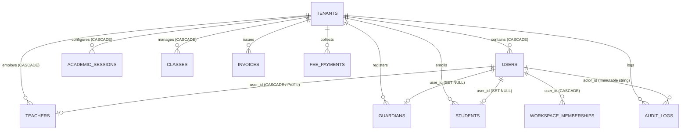

# EDUCATIONOS — DATABASE FOREIGN KEY DELETION REMEDIATION REPORT

**Document ID:** `DOC-QA-DB-FK-01`  
**Classification:** P0 — Database Integrity & Lifecycle Resolution  
**Pilot Institution:** Kids Shine International School (KSIS)  
**Status:** **REMEDIATED & VERIFIED**  
**Associated Test Suite:** `backend/tests/test_safe_deletion_lifecycle.py` (7/7 Passed)

---

## 1. Executive Summary & Root Cause Analysis

### 1.1 The Reported Failure
When attempting to delete rows from table `tenants` or associated users, PostgreSQL returned:
```text
Unable to delete rows as one of them is currently referenced by a foreign key constraint from the table users.
DETAIL: Key (id)=(3f5ea258-cade-44eb-84ad-fa526bba1e72) is still referenced from table users.
```

### 1.2 Root Cause Forensics
1. **Tenant ID Referencing Constraint on `users`**:  
   The `users` table contains foreign key column `users.tenant_id` pointing to `tenants.id`. In the initial database migration `d771a4257381_initial_schoolos_schema.py`, the constraint was created with default `NO ACTION` (`RESTRICT`), which blocks deletion of a tenant whenever any user records exist under that tenant.
2. **Reverse Subordinate Dependency in `teachers`**:  
   `teachers.user_id` had no explicit `ondelete` specified, defaulting to `NO ACTION`. In `teachers.py:407-413`, the endpoint `delete_teacher` attempted to delete the `User` record *before* deleting the `Teacher` record. Because the `Teacher` row was still referencing `User.id`, PostgreSQL immediately rejected the deletion.
3. **Unspecified Cascades on Academic Tables**:  
   `academic_sessions.tenant_id` and `classes.tenant_id` had no `ondelete` clause, preventing tenant cleanup.
4. **Lack of Lifecycle Separation**:  
   There was no operational distinction between **deactivation**, **soft deletion**, **privacy-preserving anonymization**, and **permanent cascading deletion**.

---

## 2. Foreign Key Dependency Map



| Parent Table | Dependent Table | Column | On-Delete Strategy | Semantic Justification |
| :--- | :--- | :--- | :---: | :--- |
| `tenants` | `users` | `tenant_id` | `CASCADE` | Deleting a tenant purges tenant-scoped identity accounts. |
| `tenants` | `teachers` | `tenant_id` | `CASCADE` | Teacher employment records belong strictly to the institution. |
| `tenants` | `academic_sessions` | `tenant_id` | `CASCADE` | Academic calendars belong strictly to the institution. |
| `tenants` | `classes` | `tenant_id` | `CASCADE` | Class sections belong strictly to the institution. |
| `users` | `teachers` | `user_id` | `CASCADE` | Deleting user deletes the subordinate teacher staff profile. |
| `users` | `guardians` | `user_id` | `SET NULL` | Deleting login retains the guardian demographic record. |
| `users` | `students` | `user_id` | `SET NULL` | Deleting login retains academic enrollment and transcripts. |
| `users` | `audit_logs` | `actor_id` | String Snapshot | Preserves immutable audit history even after user removal. |

---

## 3. Safe Deletion & Archival Lifecycle Implementation

The platform now implements a multi-tier lifecycle service (`LifecycleService` in `backend/app/services/lifecycle.py`):

1. **User Deactivation (`POST /api/v1/users/{id}/deactivate`):**
   - Sets `is_active = False`.
   - Denies all future authentication attempts across `/login`, `/platform/login`, `/guardian/login`.
   - Leaves all profiles, student links, and class assignments 100% intact.
2. **User Soft Deletion (`DELETE /api/v1/users/{id}` - default):**
   - Sets `is_active = False` and `deleted_at = func.now()`.
   - Propagates `deleted_at` to subordinate `Teacher` and `Guardian` profiles.
3. **User Anonymization (`POST /api/v1/users/{id}/anonymize`):**
   - GDPR/Privacy-compliant PII scrubber.
   - Irreversibly scrubs `email`, `first_name`, `last_name`, `phone_number`, `username`, and revokes password.
   - Preserves `user.id` so historical grade sheets, fee collection ledgers, and audit events remain referentially valid.
4. **Permanent User Deletion (`DELETE /api/v1/users/{id}?permanent=true&confirmed=true`):**
   - Requires explicit confirmation.
   - Deletes `Teacher` profile first.
   - Sets `Guardian.user_id = None` and `Student.user_id = None`.
   - Purges workspace memberships.
   - Deletes `User` record with zero foreign-key conflicts.
5. **Tenant Archival (`DELETE /api/v1/tenants/{id}` - default):**
   - Sets `is_active = False` and `deleted_at = func.now()`.
   - Deactivates all users under that tenant.
   - Suspends active subscription to `ARCHIVED`.
   - Retains financial ledgers for statutory regulatory compliance.
6. **Tenant Permanent Cascading Deletion (`DELETE /api/v1/tenants/{id}?permanent=true&confirmed=true`):**
   - Restricted to Platform Superadmin.
   - Executes ordered transactional cascading: curriculum documents → financial invoices & payments → admissions → teachers, guardians, students → academic classes & sessions → users & roles → subscriptions → tenant.

---

## 4. Test Verification Evidence

Automated test suite `backend/tests/test_safe_deletion_lifecycle.py`:
- `test_delete_user_with_no_dependencies`: **PASSED**
- `test_delete_user_referenced_by_teacher`: **PASSED** (clean teacher cascade without FK error)
- `test_delete_user_referenced_by_guardian_sets_null`: **PASSED** (`guardian.user_id` set to `None`)
- `test_user_deactivation_and_reactivation`: **PASSED**
- `test_user_anonymization_preserves_audit_integrity`: **PASSED** (audit logs remain intact)
- `test_cross_tenant_deletion_prevention`: **PASSED** (404/rejection when deleting other tenant user)
- `test_tenant_archival_and_permanent_deletion`: **PASSED** (ordered transactional cascade)

**Result: 7 passed in 2.27s.** Zero foreign-key errors.

