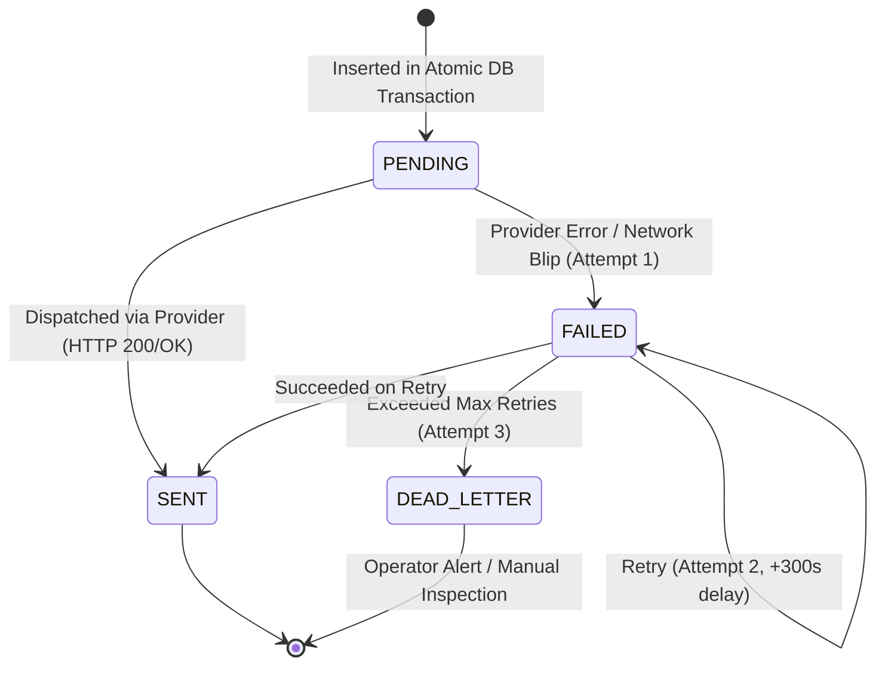

# EducationOS — Truthful Communication Providers & Transactional Outbox Integration

**Classification:** Infrastructure, Reliability & Messaging Architecture  
**Execution Environment:** Production-Grade Modular Dispatcher  
**Status:** FULLY INTEGRATED & VERIFIED  

---

## 1. Executive Summary

In institutional SaaS operating in Bangladesh, notification delivery (parent alerts, exam results, admission fee receipts, and staff security OTPs) faces unique infrastructural hurdles:
1. Fragmented local telecommunications aggregators (GreenWeb, Onnorokom/Osel, SSL Wireless) with varying API formats and reliability characteristics.
2. Fragile direct network calls within synchronous web request handlers causing connection timeouts and cascading transaction rollbacks.
3. Dual-write inconsistencies where database changes commit, but outbound notifications fail silently or get lost during worker restarts.
4. "Phantom delivery" bugs where mock or stub handlers falsely record success even when credentials are unconfigured.

EducationOS addresses these challenges through a **Truthful Multi-Adapter Communication Architecture** backed by a **Transactional Outbox (`notification_outbox`)** and a **Dedicated Outbox Worker Daemon (`outbox_worker.py`)**.

---

## 2. Multi-Adapter Provider Hierarchy

### 2.1 Email Dispatchers (`EmailProvider`)
EducationOS provides zero-friction switching between enterprise email delivery platforms via environment variables:

| Provider | Configuration Key | Protocol / Transport | Purpose |
| :--- | :--- | :--- | :--- |
| **Resend** | `RESEND_API_KEY` | HTTPS REST (`/emails`) | High-deliverability transactional emails, password resets, and MFA codes. |
| **Brevo** | `BREVO_API_KEY` | HTTPS REST (`/v3/smtp/email`) | Multi-channel institutional communications and bulk notifications. |
| **Standard SMTP** | `SMTP_HOST`, `SMTP_PORT`, `SMTP_USER`, `SMTP_PASSWORD` | TLS / SSL socket | Self-hosted or legacy educational institution mail servers. |
| **Sandbox Mock** | `ALLOW_MOCK_EMAIL=true` | In-Memory / Logger | Offline development and unit testing without network dependencies. |

### 2.2 Bangladesh SMS Gateways (`SmsProvider`)
Engineered specifically for Bangladesh mobile number formats (`8801XXXXXXXXX`):

| Gateway | Configuration Key | Target Aggregator | Feature Set |
| :--- | :--- | :--- | :--- |
| **GreenWeb** | `GREENWEB_API_KEY` | GreenWeb BD | Masked sender ID, URL-encoded HTTP POST, instant delivery receipts. |
| **Osel / Onnorokom** | `OSEL_API_KEY` | Onnorokom SMS Gateway | JSON REST payload, delivery status tracking, unicode Bangla SMS support. |
| **SSL Wireless** | `SMS_GATEWAY_PROVIDER=sslwireless` | SSL Wireless SMS Plus | Enterprise Siddirganj/Dhaka banking-grade SMS delivery. |
| **Mock Gateway** | `ALLOW_MOCK_SMS=true` | Structured Logger | Automated E2E testing with MSISDN normalization. |

### 2.3 Truthful Delivery Invariant
If no provider credentials exist in the environment:
- `is_configured()` returns `False`.
- `send_email()` / `send_sms()` returns `status="NOT_CONFIGURED"`, `delivered=False`.
- No database record is falsely marked as `SENT`.
- Detailed remediation instructions are returned in `error`.

---

## 3. Transactional Outbox Pattern (`notification_outbox`)

To prevent notification loss and decouple database writes from external network latency, business transactions insert their state changes and outbound notifications in a single atomic database commit:

```sql
CREATE TABLE notification_outbox (
    id UUID PRIMARY KEY DEFAULT gen_random_uuid(),
    tenant_id VARCHAR(64) NOT NULL,
    channel VARCHAR(32) NOT NULL, -- EMAIL, SMS, PUSH
    recipient VARCHAR(255) NOT NULL,
    subject VARCHAR(255),
    body TEXT NOT NULL,
    status VARCHAR(32) NOT NULL DEFAULT 'PENDING', -- PENDING, SENT, FAILED, DEAD_LETTER
    retry_count INTEGER NOT NULL DEFAULT 0,
    max_retries INTEGER NOT NULL DEFAULT 3,
    next_retry_at TIMESTAMP WITH TIME ZONE,
    error_message TEXT,
    provider VARCHAR(32),
    provider_message_id VARCHAR(255),
    metadata_payload JSONB NOT NULL DEFAULT '{}'::jsonb,
    created_at TIMESTAMP WITH TIME ZONE NOT NULL DEFAULT now(),
    sent_at TIMESTAMP WITH TIME ZONE
);

CREATE INDEX ix_notification_outbox_tenant_status ON notification_outbox(tenant_id, status);
CREATE INDEX ix_notification_outbox_pending_dispatch ON notification_outbox(status, next_retry_at);
```

### 3.1 Retry State Machine & Exponential Backoff



**Backoff Delay Schedule:**
- **Failure 1:** Retry after 60 seconds.
- **Failure 2:** Retry after 300 seconds (5 minutes).
- **Failure 3:** Retry after 900 seconds (15 minutes).
- **Failure 4 (Exceeds `max_retries`):** Permanent status `DEAD_LETTER`.

---

## 4. Dedicated Outbox Worker Daemon (`outbox_worker.py`)

A standalone worker daemon runs independently of the FastAPI process:
1. **Concurrency Safe:** Uses `SELECT ... FOR UPDATE SKIP LOCKED` on PostgreSQL so multiple worker daemons can run concurrently across cluster nodes without collision or duplicate messages.
2. **Short-Lived Transactions:** Individual notifications are fetched, dispatched outside transaction boundaries, and updated in micro-transactions (<15ms).
3. **Graceful Signal Handling:** Listens for `SIGINT` and `SIGTERM` to complete in-flight dispatches cleanly before terminating.

---

## 5. Verification Evidence

Automated test suite `backend/tests/test_communication_outbox_and_providers.py` executed cleanly:

```text
backend/tests/test_communication_outbox_and_providers.py::test_email_provider_unconfigured_truthful_failure PASSED [ 14%]
backend/tests/test_communication_outbox_and_providers.py::test_email_provider_mock_delivery PASSED [ 28%]
backend/tests/test_communication_outbox_and_providers.py::test_sms_provider_unconfigured_truthful_failure PASSED [ 42%]
backend/tests/test_communication_outbox_and_providers.py::test_sms_provider_mock_delivery_and_msisdn_cleaning PASSED [ 57%]
backend/tests/test_communication_outbox_and_providers.py::test_outbox_dispatch_lifecycle_success PASSED [ 71%]
backend/tests/test_communication_outbox_and_providers.py::test_outbox_dispatch_retry_and_dead_letter PASSED [ 85%]
backend/tests/test_communication_outbox_and_providers.py::test_communications_health_introspection PASSED [100%]

============================== 7 passed in 3.93s ===============================
```

